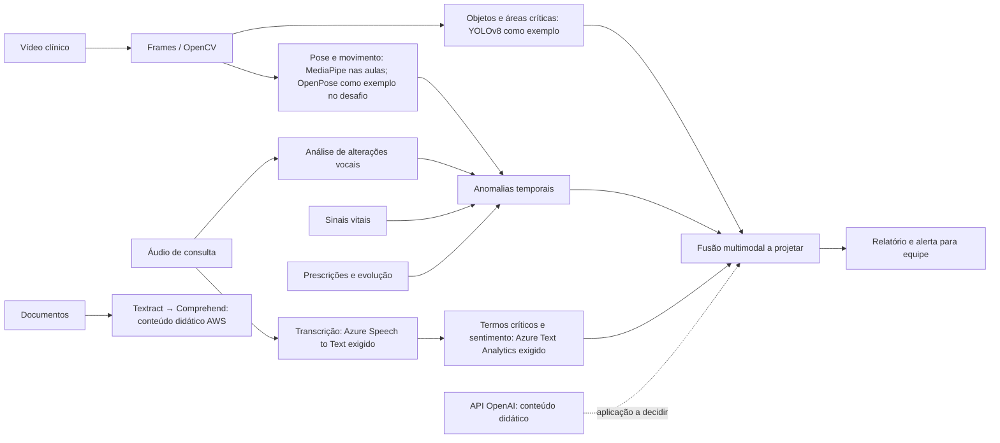

# Base de conhecimento — Fase 4: AI Text & Media

Inventário dos materiais da disciplina originalmente levantado em 13/11/2026; organização documental atualizada em 23/11/2026. Esta base resume e relaciona os materiais locais; os PDFs e exemplos originais são a fonte para conferência. [Contexto do projeto](CONTEXTO_PROJETO.md) · [Enunciado em Markdown](TECH_CHALLENGE_FASE_4.md) · [Materiais da fase](../..).

## Índice

- [Desafio e entregas](#desafio-e-entregas)
- [Grafo de conhecimento](#grafo-de-conhecimento)
- [Matéria 1 — vídeo, áudio e texto](#matéria-1--vídeo-áudio-e-texto)
- [Matéria 2 — AWS Textract e Comprehend](#matéria-2--aws-textract-e-comprehend)
- [Matéria 3 — APIs da OpenAI](#matéria-3--apis-da-openai)
- [Lacunas e decisões para o projeto](#lacunas-e-decisões-para-o-projeto)
- [Inventário completo das fontes](#inventário-completo-das-fontes)

## Desafio e entregas

O [enunciado oficial](../../IADT%20-%20Fase%204%20-%20Tech%20challenge.pdf), páginas 2–4, apresenta monitoramento preventivo de pacientes com dados de vídeo, áudio e texto, detecção de anomalias e alertas. A atividade é descrita como inicialmente em grupo, obrigatória e correspondente a 90% da nota das disciplinas da fase. Consulte prazo e instruções atuais na plataforma do curso.

| Frente | Exigência do enunciado | O que isso não demonstra |
|---|---|---|
| Vídeo | Processar vídeos clínicos, detectar eventos ou movimentos fora do padrão e gerar relatórios; OpenPose e YOLOv8 aparecem como exemplos de modelos. | As aulas de MediaPipe ou DeepFace, isoladamente, não implementam detecção de anomalias clínicas. |
| Áudio e texto | Processar áudio de consultas, detectar alterações vocais, usar Azure Speech to Text e identificar termos críticos e sentimentos com Azure Text Analytics. | Transcrição e sentimento não equivalem por si só ao diagnóstico de fadiga, disartria ou dificuldade respiratória. |
| Anomalias e alertas | Analisar séries de sinais vitais, evolução de prescrições e movimentação durante internação; gerar alertas automáticos à equipe médica. | O enunciado não especifica métrica, limiar ou dataset obrigatório; a implementação posterior está descrita no relatório técnico. |
| Entrega | Repositório com código e relatório contendo fluxo, modelos, resultados e exemplos; vídeo de até 15 minutos, no YouTube/Vimeo público ou não listado, demonstrando processamento, anomalias, Azure e fluxo de alerta. | O enunciado não especifica solução de envio de alertas nem arquitetura de produção. |

As fontes sugeridas são PhysioNet e AudioSet; são sugestões do enunciado, e adequação, licenças e acessos devem ser examinados antes de uso. O capítulo de projeto, páginas 2–3, apresenta as três disciplinas; AWS e OpenAI são conteúdo das aulas, enquanto o enunciado nomeia Azure para os requisitos de áudio/texto. O termo «tempo real» aparece no desafio e nos objetivos; a forma operacional e latência não são especificadas.

## Grafo de conhecimento

As ligações representam relações conceituais, não código existente nem arquitetura aprovada. O PDF não define como fazer a fusão, nem obriga AWS ou OpenAI no lugar de Azure.

## Matéria 1 — vídeo, áudio e texto

Os seis PDFs combinam seção prática, aprofundamento e referências. As páginas indicadas abaixo são as páginas físicas do PDF; exemplos locais estão no inventário.

1. **Reconhecimento facial:** Haar cascades, captura por webcam com OpenCV e identificação com `face_recognition`; discute iluminação, viés, consentimento e proteção de dados. O exemplo detecta/reconhece faces, não eventos cirúrgicos. [Aula 1, pp. 4–25](#inventário-completo-das-fontes).
2. **Vídeo e expressões:** frames e rostos, reconhecimento e análise de expressões com DeepFace. Expressão inferida não comprova emoção ou estado clínico; oclusão, movimento e múltiplas pessoas são dificuldades. Aula 2, pp. 4–28.
3. **Atividades e poses:** keypoints e landmarks, sequência de frames e MediaPipe. O exemplo de braços conta transições em que o cotovelo fica acima do olho; essa heurística ilustra contagem, não detecção validada de anomalia. Aula 3, pp. 4–27.
4. **Transcrição:** extração de áudio de vídeo com MoviePy e reconhecimento com SpeechRecognition; qualidade, ruído e sotaques afetam o resultado. O desafio especifica Azure, portanto esses scripts são referências conceituais. Aula 4, pp. 4–26.
5. **Classificação de texto:** exemplo supervisionado com TF-IDF e Multinomial Naive Bayes; exemplo não supervisionado com Gensim/NLTK e tópicos. Ambas as abordagens dependem dos dados usados, não substituem reconhecimento de termos clínicos validado. Aula 5, pp. 4–23.
6. **Sumarização:** leitura de DOCX, `transformers.pipeline("summarization")` e saída TXT. Verificar modelo, idioma, limites de entrada e fidelidade ao documento antes de qualquer aplicação; aula 6, pp. 4–17.

## Matéria 2 — AWS Textract e Comprehend

- **Aula 1, pp. 4–10:** visão do fluxo de digitalização, extração por OCR, estruturação de documentos e análise de linguagem. Textract e Comprehend são serviços diferentes: extração e análise de texto, respectivamente.
- **Aula 2, pp. 4–11:** configuração, armazenamento de documentos no S3 e extração de texto e estrutura de documentos pelo Textract. Preservar origem, qualidade e ordenação do texto é importante ao passar resultados adiante.
- **Aula 3, pp. 4–11:** análise de sentimento, entidades e frases-chave com Comprehend. O material menciona idiomas e divisão de texto; disponibilidade de funcionalidades deve ser verificada por idioma e região na documentação do serviço antes da implementação.

Estas aulas são referência educacional sobre extração e NLP. O desafio nomeia Azure para transcrição e análise textual; não presumir equivalência entre fornecedores ou que AWS satisfaça automaticamente esses requisitos.

## Matéria 3 — APIs da OpenAI

- **Aula 1, pp. 4–11:** introdução a IA, OpenAI e ao papel das APIs.
- **Aula 2, pp. 4–10:** autenticação, chaves e fundamentos das APIs, com exemplos históricos de modelos, embeddings e áudio. Chaves devem ficar fora do código e dos notebooks versionados.
- **Aula 3, pp. 4–9:** chamada de modelo de linguagem, mensagens e parâmetros. O notebook de apoio também demonstra imagens, transcrição/tradução de áudio e embeddings.
- **Aula 4, pp. 4–8:** geração de imagens DALL·E por instruções textuais e exemplos de variações; é conteúdo didático, não requisito explícito do desafio.
- **Aula 5, pp. 4–9:** Flask recebe um contrato DOCX ou texto e solicita extração estruturada a um modelo; o contrato é dado didático jurídico, não um registro médico. O exemplo usa chave vazia no código e modelos antigos; não deve ser exposto como serviço pronto ou copiado com credenciais embutidas.

Os notebooks mostram nomes e interfaces válidos no contexto das aulas, não uma garantia de disponibilidade atual. Antes de usar, conferir documentação oficial, custos, versões e tratamento de dados. Não foram feitas chamadas a serviços externos durante este levantamento.

## Lacunas e decisões para o projeto

- Definir com o grupo o cenário clínico, população, datasets autorizados e o que conta como anomalia para cada modalidade. Não presumir que os dados de SOP anteriores incluam vídeo, áudio ou séries vitais.
- Especificar como demonstrar processamento em tempo real, quais eventos acionam alertas e como apresentar o fluxo à equipe; o enunciado não quantifica latência nem define canal.
- Projetar avaliação por modalidade e dos alertas, com exemplos de falhas, dados ausentes, falsos positivos e limitações. As técnicas dos materiais são didáticas e não fornecem validação clínica.
- Definir o desenho de integração com Azure exigido, credenciais e custos, modo de demonstração e proteção dos dados; exemplos locais AWS/OpenAI não substituem esse requisito.
- Evitar inferir condições médicas diretamente de sentimento, expressão facial ou transcrição sem evidência e validação apropriadas; manter o papel de apoio e a revisão humana claros.

## Inventário completo das fontes

A lista cobre cada arquivo didático encontrado na pasta da Fase 4, inclusive exemplos e mídias. Links apontam aos arquivos originais; páginas são físicas nos PDFs. Os diretórios `.git` aninhados são metadados de repositórios de exemplo, não conteúdo da disciplina, e foram omitidos.

- [4IADT - Fase 4 - Capítulo Projeto.pdf](../../4IADT%20-%20Fase%204%20-%20Cap%C3%ADtulo%20Projeto.pdf) — Capítulo do projeto: apresentação das três disciplinas, pp. 2–3.

- [IADT - Fase 4 - Tech challenge.pdf](../../IADT%20-%20Fase%204%20-%20Tech%20challenge.pdf) — Enunciado oficial: desafio, requisitos e entregas, pp. 2–4.

- [Materia 1/IADT-Video_Audio_Text_Analysis/Aula 1/reconhecimento facial webcam/face_detection.py](../../Materia%201/IADT-Video_Audio_Text_Analysis/Aula%201/reconhecimento%20facial%20webcam/face_detection.py) — Captura webcam e detecção de face OpenCV.

- [Materia 1/IADT-Video_Audio_Text_Analysis/Aula 1/reconhecimento facial webcam/facial_recognition.py](../../Materia%201/IADT-Video_Audio_Text_Analysis/Aula%201/reconhecimento%20facial%20webcam/facial_recognition.py) — Identificação de faces conhecidas em webcam.

- [Materia 1/IADT-Video_Audio_Text_Analysis/Aula 1/reconhecimento facial webcam/teste.py](../../Materia%201/IADT-Video_Audio_Text_Analysis/Aula%201/reconhecimento%20facial%20webcam/teste.py) — Experimento de reconhecimento facial.

- [Materia 1/IADT-Video_Audio_Text_Analysis/Aula 2/reconhecimento facial videos/detect_expression_video.py](../../Materia%201/IADT-Video_Audio_Text_Analysis/Aula%202/reconhecimento%20facial%20videos/detect_expression_video.py) — Detecção de expressões em vídeo com DeepFace.

- [Materia 1/IADT-Video_Audio_Text_Analysis/Aula 2/reconhecimento facial videos/recognize_expression_video.py](../../Materia%201/IADT-Video_Audio_Text_Analysis/Aula%202/reconhecimento%20facial%20videos/recognize_expression_video.py) — Reconhecimento de faces conhecidas e expressões.

- [Materia 1/IADT-Video_Audio_Text_Analysis/Aula 3/Reconhecimento de poses/pose_detection_arm_up.py](../../Materia%201/IADT-Video_Audio_Text_Analysis/Aula%203/Reconhecimento%20de%20poses/pose_detection_arm_up.py) — Pose MediaPipe e contagem heurística de braços levantados.

- [Materia 1/IADT-Video_Audio_Text_Analysis/Aula 3/Reconhecimento de poses/pose_detection_video.py](../../Materia%201/IADT-Video_Audio_Text_Analysis/Aula%203/Reconhecimento%20de%20poses/pose_detection_video.py) — Landmarks de pose em vídeo.

- [Materia 1/IADT-Video_Audio_Text_Analysis/Aula 4/Transcricao de Audio/transcribe_audio.py](../../Materia%201/IADT-Video_Audio_Text_Analysis/Aula%204/Transcricao%20de%20Audio/transcribe_audio.py) — Transcrição de áudio com SpeechRecognition.

- [Materia 1/IADT-Video_Audio_Text_Analysis/Aula 4/Transcricao de Audio/transcribe_video.py](../../Materia%201/IADT-Video_Audio_Text_Analysis/Aula%204/Transcricao%20de%20Audio/transcribe_video.py) — Extração de áudio com MoviePy e transcrição.

- [Materia 1/IADT-Video_Audio_Text_Analysis/Aula 5/Classificadores/supervisioned_classifier.py](../../Materia%201/IADT-Video_Audio_Text_Analysis/Aula%205/Classificadores/supervisioned_classifier.py) — TF-IDF e classificador supervisionado Naive Bayes.

- [Materia 1/IADT-Video_Audio_Text_Analysis/Aula 5/Classificadores/unsupervisioned_classifier.py](../../Materia%201/IADT-Video_Audio_Text_Analysis/Aula%205/Classificadores/unsupervisioned_classifier.py) — Tópicos não supervisionados com Gensim e NLTK.

- [Materia 1/IADT-Video_Audio_Text_Analysis/Aula 6/Sumarizacao/documento.docx](../../Materia%201/IADT-Video_Audio_Text_Analysis/Aula%206/Sumarizacao/documento.docx) — Texto didático sobre IA usado na sumarização.

- [Materia 1/IADT-Video_Audio_Text_Analysis/Aula 6/Sumarizacao/resumo.txt](../../Materia%201/IADT-Video_Audio_Text_Analysis/Aula%206/Sumarizacao/resumo.txt) — Resumo gerado para o documento da aula.

- [Materia 1/IADT-Video_Audio_Text_Analysis/Aula 6/Sumarizacao/summarization.py](../../Materia%201/IADT-Video_Audio_Text_Analysis/Aula%206/Sumarizacao/summarization.py) — Leitura de DOCX, sumarização Transformers e saída TXT.

- [Materia 1 - Análise de video, audio e texto - Aula 01.pdf](../../Materia%201%20-%20Ana%CC%81lise%20de%20video%2C%20audio%20e%20texto%20-%20Aula%2001.pdf) — Matéria 1, aula 1: reconhecimento facial, cascatas e webcam, pp. 4–25.

- [Materia 1 - Análise de video, audio e texto - Aula 02.pdf](../../Materia%201%20-%20Ana%CC%81lise%20de%20video%2C%20audio%20e%20texto%20-%20Aula%2002.pdf) — Matéria 1, aula 2: expressões faciais em vídeo e DeepFace, pp. 4–28.

- [Materia 1 - Análise de video, audio e texto - Aula 03.pdf](../../Materia%201%20-%20Ana%CC%81lise%20de%20video%2C%20audio%20e%20texto%20-%20Aula%2003.pdf) — Matéria 1, aula 3: atividades, poses e MediaPipe, pp. 4–27.

- [Materia 1 - Análise de video, audio e texto - Aula 04.pdf](../../Materia%201%20-%20Ana%CC%81lise%20de%20video%2C%20audio%20e%20texto%20-%20Aula%2004.pdf) — Matéria 1, aula 4: áudio, vídeo e transcrição, pp. 4–26.

- [Materia 1 - Análise de video, audio e texto - Aula 05.pdf](../../Materia%201%20-%20Ana%CC%81lise%20de%20video%2C%20audio%20e%20texto%20-%20Aula%2005.pdf) — Matéria 1, aula 5: categorização e classificação textual, pp. 4–23.

- [Materia 1 - Análise de video, audio e texto - Aula 06.pdf](../../Materia%201%20-%20Ana%CC%81lise%20de%20video%2C%20audio%20e%20texto%20-%20Aula%2006.pdf) — Matéria 1, aula 6: sumarização com Transformers, pp. 4–17.

- [Materia 2 - Textract + AWS Comprehend - Aula 01 - Introdução ao Textract e AWS Comprehend.pdf](../../Materia%202%20-%20Textract%20%2B%20AWS%20Comprehend%20-%20Aula%2001%20-%20Introduc%CC%A7a%CC%83o%20ao%20Textract%20e%20AWS%20Comprehend.pdf) — Matéria 2, aula 1: introdução a Textract e Comprehend, pp. 4–10.

- [Materia 2 - Textract + AWS Comprehend - Aula 02 - Extracao de texto com Textract.pdf](../../Materia%202%20-%20Textract%20%2B%20AWS%20Comprehend%20-%20Aula%2002%20-%20Extracao%20de%20texto%20com%20Textract.pdf) — Matéria 2, aula 2: extração com Textract e S3, pp. 4–11.

- [Materia 2 - Textract + AWS Comprehend - Aula 03 - Análise de texto com AWS Comprehend.pdf](../../Materia%202%20-%20Textract%20%2B%20AWS%20Comprehend%20-%20Aula%2003%20-%20Ana%CC%81lise%20de%20texto%20com%20AWS%20Comprehend.pdf) — Matéria 2, aula 3: sentimento, entidades e frases-chave com Comprehend, pp. 4–11.

- [Materia 3/IADT-openai-api/.gitignore](../../Materia%203/IADT-openai-api/.gitignore) — Regras de exclusão do repositório didático de APIs.

- [Materia 3/IADT-openai-api/Aula 03 - APIs OpenAI.ipynb](../../Materia%203/IADT-openai-api/Aula%2003%20-%20APIs%20OpenAI.ipynb) — Exemplos de chat, imagens, áudio e embeddings.

- [Materia 3/IADT-openai-api/Aula 04 - API-DALLE.ipynb](../../Materia%203/IADT-openai-api/Aula%2004%20-%20API-DALLE.ipynb) — Exemplos de prompts, geração e variação de imagens.

- [Materia 3/IADT-openai-api/Aula 05 - Integração e Automação com a API da OpenAI.py](../../Materia%203/IADT-openai-api/Aula%2005%20-%20Integra%C3%A7%C3%A3o%20e%20Automa%C3%A7%C3%A3o%20com%20a%20API%20da%20OpenAI.py) — Aplicação Flask para extrair campos de contratos por LLM.

- [Materia 3/IADT-openai-api/CONTRATO DE LOCAÇÃO DE IMÓVEL.docx](../../Materia%203/IADT-openai-api/CONTRATO%20DE%20LOCA%C3%87%C3%83O%20DE%20IM%C3%93VEL.docx) — Contrato de locação de exemplo para extração de campos.

- [Materia 3/IADT-openai-api/Gravação.mp3](../../Materia%203/IADT-openai-api/Grava%C3%A7%C3%A3o.mp3) — Áudio MP3 mono de exemplo de transcrição; conteúdo sonoro não transcrito nem ouvido neste levantamento.

- [Materia 3 - Open API - Aula 01 - Introdução à OpenAI e Inteligência Artificial.pdf](../../Materia%203%20-%20Open%20API%20-%20Aula%2001%20-%20Introduc%CC%A7a%CC%83o%20a%CC%80%20OpenAI%20e%20Intelige%CC%82ncia%20Artificial.pdf) — Matéria 3, aula 1: OpenAI, IA e APIs, pp. 4–11.

- [Materia 3 - Open API - Aula 02 - Fundamentos da API do OpenAI.pdf](../../Materia%203%20-%20Open%20API%20-%20Aula%2002%20-%20Fundamentos%20da%20API%20do%20OpenAI.pdf) — Matéria 3, aula 2: fundamentos e autenticação da API, pp. 4–10.

- [Materia 3 - Open API - Aula 03 - Primeiros Passos com a API do GPT.pdf](../../Materia%203%20-%20Open%20API%20-%20Aula%2003%20-%20Primeiros%20Passos%20com%20a%20API%20do%20GPT.pdf) — Matéria 3, aula 3: primeiras chamadas GPT, pp. 4–9.

- [Materia 3 - Open API - Aula 04 - Trabalhando com a API DALL·E.pdf](../../Materia%203%20-%20Open%20API%20-%20Aula%2004%20-%20Trabalhando%20com%20a%20API%20DALL%C2%B7E.pdf) — Matéria 3, aula 4: geração de imagens com DALL·E, pp. 4–8.

- [Materia 3 - Open API - Aula 05 - Integração e Automação com a API da OpenAI.pdf](../../Materia%203%20-%20Open%20API%20-%20Aula%2005%20-%20Integrac%CC%A7a%CC%83o%20e%20Automac%CC%A7a%CC%83o%20com%20a%20API%20da%20OpenAI.pdf) — Matéria 3, aula 5: integração e automação, pp. 4–9.

### Cobertura e limitações de leitura

Todos os 16 PDFs tiveram texto extraído por página; o enunciado foi transcrito separadamente. Os 13 scripts Python e dois notebooks foram inspecionados estaticamente; os dois DOCX foram lidos como texto e o TXT foi conferido. O MP3 foi identificado como áudio mono MPEG, mas não foi ouvido nem transcrito. Imagens internas dos PDFs e saídas gráficas dos notebooks não foram interpretadas exaustivamente. Não houve execução dos exemplos ou validação de APIs externas.
