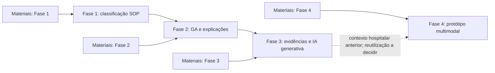
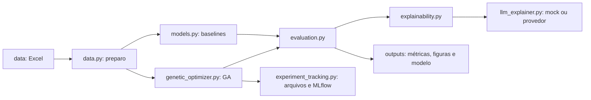
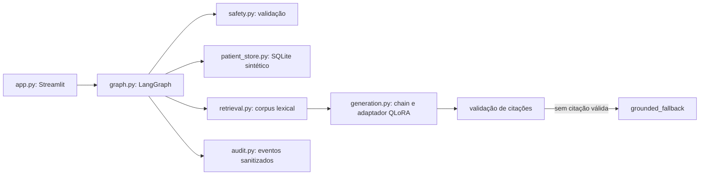

# Contexto do repositório e dos Tech Challenges

Inventário originalmente levantado em 13/11/2026; estrutura documental reorganizada em 23/11/2026. Este documento é um mapa de navegação e de padrões observados; as fontes continuam sendo os arquivos originais. [README da raiz](../../../../README.md) · [Base da Fase 4](CONTEXTO_FASE_4.md) · [Enunciado da Fase 4](TECH_CHALLENGE_FASE_4.md).

## Índice

- [Mapa e evolução](#mapa-e-evolução)
- [Fluxos e componentes](#fluxos-e-componentes)
- [Padrões técnicos observados](#padrões-técnicos-observados)
- [Materiais, dados e artefatos](#materiais-dados-e-artefatos)
- [Inventário pesquisável](#inventário-pesquisável)

## Mapa e evolução

| Área | Conteúdo e entrada | Estado documentado |
|---|---|---|
| [Fase 1](../../../../Tech%20Challenge/Fase%201/README.md) | Notebook de SOP; EDA, engenharia de atributos, quatro classificadores, avaliação e SHAP; dados em `data/`. | Random Forest: maior F1 informado; regressão logística: maior recall informado. Projeto acadêmico. |
| [Fase 2](../../../../Tech%20Challenge/Fase%202/README.md) | Evolução direta: pacote `pcos_fase2`, baselines, otimização genética, avaliação, explicabilidade, tracking e LLM. | O GA principal não supera o Random Forest baseline no teste; há investigação adicional de threshold. Ver [relatório](../../../Fase%202%20-%20Evolu%C3%A7%C3%A3o%20da%20IA/RELATORIO_TECNICO.md). |
| [Fase 3](../../../../Tech%20Challenge/Fase%203/README.md) | Protótipo Streamlit para evidências de SOP com QLoRA, LangChain, LangGraph, SQLite, recuperação lexical e auditoria. | 12 registros sintéticos; 600 exemplos instrucionais; geração sem citação válida usa fallback. O README informa que falta gravar o vídeo; não há validação clínica. |
| [Fase 4](CONTEXTO_FASE_4.md) | Protótipo acadêmico para dados multimodais de fisioterapia e anomalias. | [Código e reprodução](../../../../Tech%20Challenge/Fase%204/README.md); [relatório técnico](../relatorios/RELATORIO_TECNICO.md); resultados computacionais em `Tech Challenge/Fase 4/docs/resultados/`. |

A seta pontilhada representa relação conceitual, não uma integração implementada. Leia os enunciados de cada fase antes de pressupor dependências entre soluções.

## Fluxos e componentes

### Fase 1

O [notebook principal](../../../../Tech%20Challenge/Fase%201/code/pcos_diagnostico.ipynb) carrega Excel e CSV, limpa dados, explora distribuições, cria atributos, separa treino/teste, avalia modelos e produz gráficos e explicações. O notebook executado e os gráficos são artefatos derivados. Os dados são apresentados no README como 541 pacientes, de uma origem geográfica específica; as métricas não comprovam uso clínico.

### Fase 2

`advanced_tuning.py` separa a investigação adicional; `scaling.py` calcula workers e `logging_setup.py` configura logs. `scripts/` oferece comandos para baselines, jobs, grade, consolidação, relatórios e orquestração. `tests/` cobre componentes. Ver [README](../../../../Tech%20Challenge/Fase%202/README.md) e [relatório](../../../Fase%202%20-%20Evolu%C3%A7%C3%A3o%20da%20IA/RELATORIO_TECNICO.md).

### Fase 3

`config.py` centraliza caminhos e limites; `models.py` contém modelos de entrada e auditoria. `scripts/` gera dados, prepara corpus, treina e avalia; `docs/` reúne relatório, inventário clínico, roteiro e notebook de treino. O [README](../../../../Tech%20Challenge/Fase%203/README.md) registra 44 casos de recuperação e comparação de 270 respostas; seus resultados são exploratórios.

## Padrões técnicos observados

Esta seção foi derivada **somente de `Tech Challenge/`**. Os exemplos são observações, não regras já aprovadas para a Fase 4.

- **Organização:** a Fase 1 concentra fluxo no notebook `code/pcos_diagnostico.ipynb`, com `data/` e `code/graficos/`; as fases 2 e 3 usam `code/src/pcos_fase2` ou `pcos_fase3`, `code/scripts/`, `code/tests/` e `code/outputs/`. A Fase 3 também separa `data/raw`, `processed`, `synthetic`, `eval` e `docs/`.
- **Módulos e funções:** nomes em inglês e `snake_case`, geralmente por responsabilidade, como `genetic_optimizer.py`, `patient_store.py`, `prepare_data`, `retrieve` e `run_triage`; funções auxiliares privadas usam prefixo `_`, por exemplo `_normalize`.
- **Tipos e atributos:** classes em `PascalCase`, como `PreparedData`, `ModelMetrics`, `TriageRequest` e `TriageState`; atributos em `snake_case`, como `patient_id` e `source_ids`. Há `dataclass` na Fase 2 e Pydantic/`TypedDict` na Fase 3, além de anotações de tipo em boa parte do código.
- **Constantes e configuração:** `UPPER_SNAKE_CASE`, por exemplo `RANDOM_STATE`, `MODEL_NAME` e `RETRIEVAL_K`; `config.py` usa `pathlib.Path` para caminhos e concentra parâmetros. Configuração sensível de exemplo aparece em `code/.env.example` da Fase 3.
- **Execução:** nomes de scripts orientados à ação, como `run_baseline.py`, `generate_instruction_data.py` e `run_evaluation.py`. Dependências são declaradas em `requirements*.txt`; a Fase 3 separa dependências de desenvolvimento, modelo e treinamento.
- **Testes e saídas:** arquivos `test_*.py` e `conftest.py` com pytest nas fases 2 e 3; saídas em `outputs/`, com métricas CSV/JSON/JSONL, figuras e modelos. A Fase 1 traz gráficos PNG e notebook executado, sem a mesma estrutura de testes.
- **Documentação:** README por fase, relatório técnico em Markdown e, na Fase 3, fontes e roteiro de vídeo em `docs/`. A documentação mistura português com nomes técnicos em inglês e varia no uso de acentos; não existe uma convenção uniforme de acentuação.

## Materiais, dados e artefatos

`Materiais/` organiza conteúdo didático e documentos de entrega por fase: PDFs de aulas e enunciados, exemplos, notebooks, relatórios, roteiros, apresentações e guias. Os projetos executáveis permanecem em `Tech Challenge/`. A Fase 4 reúne três matérias: análise de vídeo/áudio/texto, AWS Textract/Comprehend e OpenAI; o desafio solicita explicitamente Azure Speech to Text e Azure Text Analytics. Consulte a [base específica](CONTEXTO_FASE_4.md) para o inventário comentado de cada arquivo da fase.

`Tech Challenge/` guarda implementações e entregas. Dados, métricas, notebooks executados, modelos serializados e imagens são artefatos de suas respectivas fases; não devem ser confundidos com novas validações. O adaptador `safetensors` da Fase 3 não contém o modelo-base completo. Os repositórios Git aninhados nos materiais da Fase 4 são metadados de exemplos didáticos e não compõem os projetos das fases anteriores.

## Inventário pesquisável

O índice a seguir lista arquivos didáticos encontrados no levantamento original, agrupados por diretório. A documentação e os materiais de apoio do projeto da Fase 4 foram reorganizados em `Materiais/Fase 4 - AI Text & Media/Projeto de monitoramento multimodal/`; consulte os índices dessa pasta para a organização atual.  Use a busca do editor para encontrar nomes ou extensões. Arquivos em `.git`, ambientes virtuais, caches e metadados do sistema foram excluídos; binários e datasets são identificados pelo nome, sem alegação de leitura integral. Os documentos da Fase 4 possuem inventário de fontes comentado na [base específica](CONTEXTO_FASE_4.md).

### Materiais/Fase 1

- [CONTEXT.md](../../../Fase%201/CONTEXT.md)
- [Roteiro_Apresentacao_Video.md](../../../Fase%201/Roteiro_Apresentacao_Video.md)
- [Roteiro_Notebook_Video.md](../../../Fase%201/Roteiro_Notebook_Video.md)
- [Tech_Challenge_Fase1_Apresentacao.pptx](../../../Fase%201/Tech_Challenge_Fase1_Apresentacao.pptx)
- [Tech_Challenge_Fase1_PCOS_Relatorio.pdf](../../../Fase%201/Tech_Challenge_Fase1_PCOS_Relatorio.pdf)
- [fiap_logo_cover.jpg](../../../Fase%201/fiap_logo_cover.jpg)
- [polycystic-ovary-syndrome-pcos.zip](../../../Fase%201/polycystic-ovary-syndrome-pcos.zip)
- [postech_logo_cover.png](../../../Fase%201/postech_logo_cover.png)

### Materiais/Fase 1/Aulas

- [IADT - Fase 1 - Tech challenge A.pdf](../../../Fase%201/Aulas/IADT%20-%20Fase%201%20-%20Tech%20challenge%20A.pdf)

### Materiais/Fase 1/Aulas/Compute Vision

- [POSTECH - Aula 04.pdf](../../../Fase%201/Aulas/Compute%20Vision/POSTECH%20-%20Aula%2004.pdf)
- [POSTECH - Aula 05.pdf](../../../Fase%201/Aulas/Compute%20Vision/POSTECH%20-%20Aula%2005.pdf)
- [POSTECH - Aula 06.pdf](../../../Fase%201/Aulas/Compute%20Vision/POSTECH%20-%20Aula%2006.pdf)
- [PÓSTECH - Aula 01.pdf](../../../Fase%201/Aulas/Compute%20Vision/P%C3%93STECH%20-%20Aula%2001.pdf)
- [PÓSTECH - Aula 02.pdf](../../../Fase%201/Aulas/Compute%20Vision/P%C3%93STECH%20-%20Aula%2002.pdf)
- [PÓSTECH - Aula 03.pdf](../../../Fase%201/Aulas/Compute%20Vision/P%C3%93STECH%20-%20Aula%2003.pdf)

### Materiais/Fase 1/Aulas/Machine Learning

- [POSTECH - Machine Learning - Aula 1.pdf](../../../Fase%201/Aulas/Machine%20Learning/POSTECH%20-%20Machine%20Learning%20-%20Aula%201.pdf)
- [POSTECH - Machine Learning - Aula 2.pdf](../../../Fase%201/Aulas/Machine%20Learning/POSTECH%20-%20Machine%20Learning%20-%20Aula%202.pdf)
- [POSTECH - Machine Learning - Aula 3.pdf](../../../Fase%201/Aulas/Machine%20Learning/POSTECH%20-%20Machine%20Learning%20-%20Aula%203.pdf)
- [POSTECH - Machine Learning - Aula 4.pdf](../../../Fase%201/Aulas/Machine%20Learning/POSTECH%20-%20Machine%20Learning%20-%20Aula%204.pdf)

### Materiais/Fase 1/Aulas/Machine Learning Avancado

- [PÓS-GRADUAÇÃO ON - Machine Learning Avançado Aula 1.pdf](../../../Fase%201/Aulas/Machine%20Learning%20Avancado/P%C3%93S-GRADUA%C3%87%C3%83O%20ON%20-%20Machine%20Learning%20Avan%C3%A7ado%20Aula%201.pdf)
- [PÓS-GRADUAÇÃO ON - Machine Learning Avançado Aula 2.pdf](../../../Fase%201/Aulas/Machine%20Learning%20Avancado/P%C3%93S-GRADUA%C3%87%C3%83O%20ON%20-%20Machine%20Learning%20Avan%C3%A7ado%20Aula%202.pdf)
- [PÓS-GRADUAÇÃO ON - Machine Learning Avançado Aula 3.pdf](../../../Fase%201/Aulas/Machine%20Learning%20Avancado/P%C3%93S-GRADUA%C3%87%C3%83O%20ON%20-%20Machine%20Learning%20Avan%C3%A7ado%20Aula%203.pdf)
- [PÓS-GRADUAÇÃO ON - Machine Learning Avançado Aula 4.pdf](../../../Fase%201/Aulas/Machine%20Learning%20Avancado/P%C3%93S-GRADUA%C3%87%C3%83O%20ON%20-%20Machine%20Learning%20Avan%C3%A7ado%20Aula%204.pdf)
- [PÓS-GRADUAÇÃO ON - Machine Learning Avançado Aula 5.pdf](../../../Fase%201/Aulas/Machine%20Learning%20Avancado/P%C3%93S-GRADUA%C3%87%C3%83O%20ON%20-%20Machine%20Learning%20Avan%C3%A7ado%20Aula%205.pdf)
- [PÓS-GRADUAÇÃO ON - Machine Learning Avançado Aula 6.pdf](../../../Fase%201/Aulas/Machine%20Learning%20Avancado/P%C3%93S-GRADUA%C3%87%C3%83O%20ON%20-%20Machine%20Learning%20Avan%C3%A7ado%20Aula%206.pdf)
- [PÓS-GRADUAÇÃO ON - Machine Learning Avançado Aula 7.pdf](../../../Fase%201/Aulas/Machine%20Learning%20Avancado/P%C3%93S-GRADUA%C3%87%C3%83O%20ON%20-%20Machine%20Learning%20Avan%C3%A7ado%20Aula%207.pdf)

### Materiais/Fase 1/code

- [README.md](../../../Fase%201/code/README.md)
- [pcos_diagnostico.ipynb](../../../Fase%201/code/pcos_diagnostico.ipynb)
- [pcos_diagnostico_executado.ipynb](../../../Fase%201/code/pcos_diagnostico_executado.ipynb)

### Materiais/Fase 1/code/graficos

- [01_distribuicao_target.png](../../../Fase%201/code/graficos/01_distribuicao_target.png)
- [02_distribuicao_features_clinicas.png](../../../Fase%201/code/graficos/02_distribuicao_features_clinicas.png)
- [03_boxplots_features.png](../../../Fase%201/code/graficos/03_boxplots_features.png)
- [04_prevalencia_sintomas.png](../../../Fase%201/code/graficos/04_prevalencia_sintomas.png)
- [05_correlacao_com_target.png](../../../Fase%201/code/graficos/05_correlacao_com_target.png)
- [05_heatmap_correlacao.png](../../../Fase%201/code/graficos/05_heatmap_correlacao.png)
- [06_heatmap_correlacao.png](../../../Fase%201/code/graficos/06_heatmap_correlacao.png)
- [07_matrizes_confusao.png](../../../Fase%201/code/graficos/07_matrizes_confusao.png)
- [08_curvas_roc.png](../../../Fase%201/code/graficos/08_curvas_roc.png)
- [09_feature_importance.png](../../../Fase%201/code/graficos/09_feature_importance.png)
- [10_shap_summary.png](../../../Fase%201/code/graficos/10_shap_summary.png)
- [11_shap_bar.png](../../../Fase%201/code/graficos/11_shap_bar.png)
- [12_shap_waterfall.png](../../../Fase%201/code/graficos/12_shap_waterfall.png)
- [fe_01_novas_features.png](../../../Fase%201/code/graficos/fe_01_novas_features.png)

### Materiais/Fase 1/pcos_data

- [PCOS_data_without_infertility.xlsx](../../../Fase%201/pcos_data/PCOS_data_without_infertility.xlsx)
- [PCOS_infertility.csv](../../../Fase%201/pcos_data/PCOS_infertility.csv)

### Materiais/Fase 2 - Evolução da IA

- [CONTEXTO_LOCAL_IA.md](../../../Fase%202%20-%20Evolu%C3%A7%C3%A3o%20da%20IA/CONTEXTO_LOCAL_IA.md)
- [CONTEXTO_TECH_CHALLENGE_FASE2.md](../../../Fase%202%20-%20Evolu%C3%A7%C3%A3o%20da%20IA/CONTEXTO_TECH_CHALLENGE_FASE2.md)
- [Capítulo de Projeto - 4IADT - Fase 2.pdf](../../../Fase%202%20-%20Evolu%C3%A7%C3%A3o%20da%20IA/Cap%C3%ADtulo%20de%20Projeto%20-%204IADT%20-%20Fase%202.pdf)
- [IADT - Fase 2 - Tech challenge.pdf](../../../Fase%202%20-%20Evolu%C3%A7%C3%A3o%20da%20IA/IADT%20-%20Fase%202%20-%20Tech%20challenge.pdf)
- [POSTECH - Aula 1 - Introdução a IA Generativa.pdf](../../../Fase%202%20-%20Evolu%C3%A7%C3%A3o%20da%20IA/POSTECH%20-%20Aula%201%20-%20Introdu%C3%A7%C3%A3o%20a%20IA%20Generativa.pdf)
- [POSTECH - Aula 2 - Fundamentos da IA Generativa.pdf](../../../Fase%202%20-%20Evolu%C3%A7%C3%A3o%20da%20IA/POSTECH%20-%20Aula%202%20-%20Fundamentos%20da%20IA%20Generativa.pdf)
- [POSTECH - Aula 3 - O uso de IAs Generativas na geração de códigos^J imagens e vídeos.pdf](../../../Fase%202%20-%20Evolu%C3%A7%C3%A3o%20da%20IA/POSTECH%20-%20Aula%203%20-%20O%20uso%20de%20IAs%20Generativas%20na%20gera%C3%A7%C3%A3o%20de%20c%C3%B3digos%5EJ%20imagens%20e%20v%C3%ADdeos.pdf)
- [POSTECH - Aula 4 - Projetos Práticos com a IA generativa.pdf](../../../Fase%202%20-%20Evolu%C3%A7%C3%A3o%20da%20IA/POSTECH%20-%20Aula%204%20-%20Projetos%20Pr%C3%A1ticos%20com%20a%20IA%20generativa.pdf)
- [POSTECH - Aula 5 - Os desafios éticos das IAs Generativas na criação de conteúdo.pdf](../../../Fase%202%20-%20Evolu%C3%A7%C3%A3o%20da%20IA/POSTECH%20-%20Aula%205%20-%20Os%20desafios%20%C3%A9ticos%20das%20IAs%20Generativas%20na%20cria%C3%A7%C3%A3o%20de%20conte%C3%BAdo.pdf)
- [POSTECH - Desenvolvimento de ML na cloud - Aula 1.pdf](../../../Fase%202%20-%20Evolu%C3%A7%C3%A3o%20da%20IA/POSTECH%20-%20Desenvolvimento%20de%20ML%20na%20cloud%20-%20Aula%201.pdf)
- [POSTECH - Desenvolvimento de ML na cloud - Aula 2.pdf](../../../Fase%202%20-%20Evolu%C3%A7%C3%A3o%20da%20IA/POSTECH%20-%20Desenvolvimento%20de%20ML%20na%20cloud%20-%20Aula%202.pdf)
- [POSTECH - Desenvolvimento de ML na cloud - Aula 3.pdf](../../../Fase%202%20-%20Evolu%C3%A7%C3%A3o%20da%20IA/POSTECH%20-%20Desenvolvimento%20de%20ML%20na%20cloud%20-%20Aula%203.pdf)
- [POSTECH - Desvendando o poder das LLMs - Aula 1.pdf](../../../Fase%202%20-%20Evolu%C3%A7%C3%A3o%20da%20IA/POSTECH%20-%20Desvendando%20o%20poder%20das%20LLMs%20-%20Aula%201.pdf)
- [POSTECH - Desvendando o poder das LLMs - Aula 2.pdf](../../../Fase%202%20-%20Evolu%C3%A7%C3%A3o%20da%20IA/POSTECH%20-%20Desvendando%20o%20poder%20das%20LLMs%20-%20Aula%202.pdf)
- [POSTECH - Desvendando o poder das LLMs - Aula 3.pdf](../../../Fase%202%20-%20Evolu%C3%A7%C3%A3o%20da%20IA/POSTECH%20-%20Desvendando%20o%20poder%20das%20LLMs%20-%20Aula%203.pdf)
- [POSTECH - Desvendando o poder das LLMs - Aula 4.pdf](../../../Fase%202%20-%20Evolu%C3%A7%C3%A3o%20da%20IA/POSTECH%20-%20Desvendando%20o%20poder%20das%20LLMs%20-%20Aula%204.pdf)
- [POSTECH - Desvendando o poder das LLMs - Aula 5.pdf](../../../Fase%202%20-%20Evolu%C3%A7%C3%A3o%20da%20IA/POSTECH%20-%20Desvendando%20o%20poder%20das%20LLMs%20-%20Aula%205.pdf)
- [POSTECH - Introducao Algoritmo Genetico - Aula 1.pdf](../../../Fase%202%20-%20Evolu%C3%A7%C3%A3o%20da%20IA/POSTECH%20-%20Introducao%20Algoritmo%20Genetico%20-%20Aula%201.pdf)
- [POSTECH - Introducao Algoritmo Genetico - Aula 2.pdf](../../../Fase%202%20-%20Evolu%C3%A7%C3%A3o%20da%20IA/POSTECH%20-%20Introducao%20Algoritmo%20Genetico%20-%20Aula%202.pdf)
- [POSTECH - Introducao Algoritmo Genetico - Aula 3.pdf](../../../Fase%202%20-%20Evolu%C3%A7%C3%A3o%20da%20IA/POSTECH%20-%20Introducao%20Algoritmo%20Genetico%20-%20Aula%203.pdf)
- [POSTECH - Introducao Algoritmo Genetico - Aula 4.pdf](../../../Fase%202%20-%20Evolu%C3%A7%C3%A3o%20da%20IA/POSTECH%20-%20Introducao%20Algoritmo%20Genetico%20-%20Aula%204.pdf)
- [POSTECH - Introducao Algoritmo Genetico - Aula 5.pdf](../../../Fase%202%20-%20Evolu%C3%A7%C3%A3o%20da%20IA/POSTECH%20-%20Introducao%20Algoritmo%20Genetico%20-%20Aula%205.pdf)
- [POSTECH - Processamento de Linguagem Natural - Aula 1.pdf](../../../Fase%202%20-%20Evolu%C3%A7%C3%A3o%20da%20IA/POSTECH%20-%20Processamento%20de%20Linguagem%20Natural%20-%20Aula%201.pdf)
- [POSTECH - Processamento de Linguagem Natural - Aula 2.pdf](../../../Fase%202%20-%20Evolu%C3%A7%C3%A3o%20da%20IA/POSTECH%20-%20Processamento%20de%20Linguagem%20Natural%20-%20Aula%202.pdf)
- [POSTECH - Processamento de Linguagem Natural - Aula 3.pdf](../../../Fase%202%20-%20Evolu%C3%A7%C3%A3o%20da%20IA/POSTECH%20-%20Processamento%20de%20Linguagem%20Natural%20-%20Aula%203.pdf)
- [POSTECH - Processamento de Linguagem Natural - Aula 4.pdf](../../../Fase%202%20-%20Evolu%C3%A7%C3%A3o%20da%20IA/POSTECH%20-%20Processamento%20de%20Linguagem%20Natural%20-%20Aula%204.pdf)
- [POSTECH - Processamento de Linguagem Natural - Aula 5.pdf](../../../Fase%202%20-%20Evolu%C3%A7%C3%A3o%20da%20IA/POSTECH%20-%20Processamento%20de%20Linguagem%20Natural%20-%20Aula%205.pdf)
- [POSTECH - Processamento de Linguagem Natural - Aula 6.pdf](../../../Fase%202%20-%20Evolu%C3%A7%C3%A3o%20da%20IA/POSTECH%20-%20Processamento%20de%20Linguagem%20Natural%20-%20Aula%206.pdf)
- [ROTEIRO_VIDEO_FALA.md](../../../Fase%202%20-%20Evolu%C3%A7%C3%A3o%20da%20IA/ROTEIRO_VIDEO_FALA.md)
- [ROTEIRO_VIDEO_TELA.md](../../../Fase%202%20-%20Evolu%C3%A7%C3%A3o%20da%20IA/ROTEIRO_VIDEO_TELA.md)

### Materiais/Fase 3 - Generative AI

- [Materia 1 - O Chat-GPT_Como extrair o maximo da ferramenta no seu dia-a-dia - Aula 1.pdf](../../../Fase%203%20-%20Generative%20AI/Materia%201%20-%20O%20Chat-GPT_Como%20extrair%20o%20maximo%20da%20ferramenta%20no%20seu%20dia-a-dia%20-%20Aula%201.pdf)
- [Materia 1 - O Chat-GPT_Como extrair o maximo da ferramenta no seu dia-a-dia - Aula 2.pdf](../../../Fase%203%20-%20Generative%20AI/Materia%201%20-%20O%20Chat-GPT_Como%20extrair%20o%20maximo%20da%20ferramenta%20no%20seu%20dia-a-dia%20-%20Aula%202.pdf)
- [Materia 1 - O Chat-GPT_Como extrair o maximo da ferramenta no seu dia-a-dia - Aula 3.pdf](../../../Fase%203%20-%20Generative%20AI/Materia%201%20-%20O%20Chat-GPT_Como%20extrair%20o%20maximo%20da%20ferramenta%20no%20seu%20dia-a-dia%20-%20Aula%203.pdf)
- [Materia 1 - O Chat-GPT_Como extrair o maximo da ferramenta no seu dia-a-dia - Aula 4.pdf](../../../Fase%203%20-%20Generative%20AI/Materia%201%20-%20O%20Chat-GPT_Como%20extrair%20o%20maximo%20da%20ferramenta%20no%20seu%20dia-a-dia%20-%20Aula%204.pdf)
- [Materia 2 - IA_Guia de Prompts - Aula 1.pdf](../../../Fase%203%20-%20Generative%20AI/Materia%202%20-%20IA_Guia%20de%20Prompts%20-%20Aula%201.pdf)
- [Materia 2 - IA_Guia de Prompts - Aula 2.pdf](../../../Fase%203%20-%20Generative%20AI/Materia%202%20-%20IA_Guia%20de%20Prompts%20-%20Aula%202.pdf)
- [Materia 2 - IA_Guia de Prompts - Aula 3.pdf](../../../Fase%203%20-%20Generative%20AI/Materia%202%20-%20IA_Guia%20de%20Prompts%20-%20Aula%203.pdf)
- [Materia 2 - IA_Guia de Prompts - Aula 4.pdf](../../../Fase%203%20-%20Generative%20AI/Materia%202%20-%20IA_Guia%20de%20Prompts%20-%20Aula%204.pdf)
- [Materia 2 - IA_Guia de Prompts - Aula 5.pdf](../../../Fase%203%20-%20Generative%20AI/Materia%202%20-%20IA_Guia%20de%20Prompts%20-%20Aula%205.pdf)
- [Materia 2 - IA_Guia de Prompts - Aula 6.pdf](../../../Fase%203%20-%20Generative%20AI/Materia%202%20-%20IA_Guia%20de%20Prompts%20-%20Aula%206.pdf)
- [Materia 3 - Fine-tuning e rag para documentos - Aula 1.pdf](../../../Fase%203%20-%20Generative%20AI/Materia%203%20-%20Fine-tuning%20e%20rag%20para%20documentos%20-%20Aula%201.pdf)
- [Materia 3 - Fine-tuning e rag para documentos - Aula 2.pdf](../../../Fase%203%20-%20Generative%20AI/Materia%203%20-%20Fine-tuning%20e%20rag%20para%20documentos%20-%20Aula%202.pdf)
- [Materia 3 - Fine-tuning e rag para documentos - Aula 3.pdf](../../../Fase%203%20-%20Generative%20AI/Materia%203%20-%20Fine-tuning%20e%20rag%20para%20documentos%20-%20Aula%203.pdf)
- [Materia 4 - LangChain na prática - Aula 1.pdf](../../../Fase%203%20-%20Generative%20AI/Materia%204%20-%20LangChain%20na%20pr%C3%A1tica%20-%20Aula%201.pdf)
- [Materia 4 - LangChain na prática - Aula 2.pdf](../../../Fase%203%20-%20Generative%20AI/Materia%204%20-%20LangChain%20na%20pr%C3%A1tica%20-%20Aula%202.pdf)
- [Materia 4 - LangChain na prática - Aula 3.pdf](../../../Fase%203%20-%20Generative%20AI/Materia%204%20-%20LangChain%20na%20pr%C3%A1tica%20-%20Aula%203.pdf)
- [Materia 4 - LangChain na prática - Aula 4.pdf](../../../Fase%203%20-%20Generative%20AI/Materia%204%20-%20LangChain%20na%20pr%C3%A1tica%20-%20Aula%204.pdf)
- [Materia 4 - LangChain na prática - Aula 5.pdf](../../../Fase%203%20-%20Generative%20AI/Materia%204%20-%20LangChain%20na%20pr%C3%A1tica%20-%20Aula%205.pdf)
- [Materia 4 - LangChain na prática - Aula 6.pdf](../../../Fase%203%20-%20Generative%20AI/Materia%204%20-%20LangChain%20na%20pr%C3%A1tica%20-%20Aula%206.pdf)
- [Materia 5 - LangGraph - Aula 1.pdf](../../../Fase%203%20-%20Generative%20AI/Materia%205%20-%20LangGraph%20-%20Aula%201.pdf)
- [Materia 5 - LangGraph - Aula 2.pdf](../../../Fase%203%20-%20Generative%20AI/Materia%205%20-%20LangGraph%20-%20Aula%202.pdf)
- [Materia 5 - LangGraph - Aula 3.pdf](../../../Fase%203%20-%20Generative%20AI/Materia%205%20-%20LangGraph%20-%20Aula%203.pdf)
- [Materia 5 - LangGraph - Aula 4.pdf](../../../Fase%203%20-%20Generative%20AI/Materia%205%20-%20LangGraph%20-%20Aula%204.pdf)

### Materiais/Fase 3 - Generative AI/Materia 3 - Material Complementar

- [formatted_news_dataset_chat_data.json](../../../Fase%203%20-%20Generative%20AI/Materia%203%20-%20Material%20Complementar/formatted_news_dataset_chat_data.json)
- [news_dataset_chat_data.json](../../../Fase%203%20-%20Generative%20AI/Materia%203%20-%20Material%20Complementar/news_dataset_chat_data.json)

### Materiais/Fase 3 - Generative AI/Materia 3 - Material Complementar/Aula 01 - Preparando dados de treinamento para fine-tuning

- [CNN_Links.txt](../../../Fase%203%20-%20Generative%20AI/Materia%203%20-%20Material%20Complementar/Aula%2001%20-%20Preparando%20dados%20de%20treinamento%20para%20fine-tuning/CNN_Links.txt)
- [data.jsonl](../../../Fase%203%20-%20Generative%20AI/Materia%203%20-%20Material%20Complementar/Aula%2001%20-%20Preparando%20dados%20de%20treinamento%20para%20fine-tuning/data.jsonl)
- [generate-output-for-news.ipynb](../../../Fase%203%20-%20Generative%20AI/Materia%203%20-%20Material%20Complementar/Aula%2001%20-%20Preparando%20dados%20de%20treinamento%20para%20fine-tuning/generate-output-for-news.ipynb)
- [get-news-content.ipynb](../../../Fase%203%20-%20Generative%20AI/Materia%203%20-%20Material%20Complementar/Aula%2001%20-%20Preparando%20dados%20de%20treinamento%20para%20fine-tuning/get-news-content.ipynb)
- [news-scrapper.ipynb](../../../Fase%203%20-%20Generative%20AI/Materia%203%20-%20Material%20Complementar/Aula%2001%20-%20Preparando%20dados%20de%20treinamento%20para%20fine-tuning/news-scrapper.ipynb)
- [news_contents.json](../../../Fase%203%20-%20Generative%20AI/Materia%203%20-%20Material%20Complementar/Aula%2001%20-%20Preparando%20dados%20de%20treinamento%20para%20fine-tuning/news_contents.json)
- [news_dataset_chat_data.json](../../../Fase%203%20-%20Generative%20AI/Materia%203%20-%20Material%20Complementar/Aula%2001%20-%20Preparando%20dados%20de%20treinamento%20para%20fine-tuning/news_dataset_chat_data.json)
- [news_summaries.json](../../../Fase%203%20-%20Generative%20AI/Materia%203%20-%20Material%20Complementar/Aula%2001%20-%20Preparando%20dados%20de%20treinamento%20para%20fine-tuning/news_summaries.json)
- [prepare-data.ipynb](../../../Fase%203%20-%20Generative%20AI/Materia%203%20-%20Material%20Complementar/Aula%2001%20-%20Preparando%20dados%20de%20treinamento%20para%20fine-tuning/prepare-data.ipynb)

### Materiais/Fase 3 - Generative AI/Materia 3 - Material Complementar/Aula 02 - Fine tuning de LLM para documentos

- [entendendo-llms.ipynb](../../../Fase%203%20-%20Generative%20AI/Materia%203%20-%20Material%20Complementar/Aula%2002%20-%20Fine%20tuning%20de%20LLM%20para%20documentos/entendendo-llms.ipynb)
- [finetuning_summarizer.ipynb](../../../Fase%203%20-%20Generative%20AI/Materia%203%20-%20Material%20Complementar/Aula%2002%20-%20Fine%20tuning%20de%20LLM%20para%20documentos/finetuning_summarizer.ipynb)

### Materiais/Fase 3 - Generative AI/Materia 3 - Material Complementar/Aula 03 - RAG para documentos

- [CNN_Links.txt](../../../Fase%203%20-%20Generative%20AI/Materia%203%20-%20Material%20Complementar/Aula%2003%20-%20RAG%20para%20documentos/CNN_Links.txt)
- [rag-application.ipynb](../../../Fase%203%20-%20Generative%20AI/Materia%203%20-%20Material%20Complementar/Aula%2003%20-%20RAG%20para%20documentos/rag-application.ipynb)

### Materiais/Fase 3 - Generative AI/Materia 5 - Material complementar

- [aula_1_video_1.ipynb](../../../Fase%203%20-%20Generative%20AI/Materia%205%20-%20Material%20complementar/aula_1_video_1.ipynb)
- [aula_1_video_2.ipynb](../../../Fase%203%20-%20Generative%20AI/Materia%205%20-%20Material%20complementar/aula_1_video_2.ipynb)
- [aula_1_video_3.ipynb](../../../Fase%203%20-%20Generative%20AI/Materia%205%20-%20Material%20complementar/aula_1_video_3.ipynb)
- [aula_2_video_1.ipynb](../../../Fase%203%20-%20Generative%20AI/Materia%205%20-%20Material%20complementar/aula_2_video_1.ipynb)
- [aula_2_video_2.ipynb](../../../Fase%203%20-%20Generative%20AI/Materia%205%20-%20Material%20complementar/aula_2_video_2.ipynb)
- [aula_2_video_3.ipynb](../../../Fase%203%20-%20Generative%20AI/Materia%205%20-%20Material%20complementar/aula_2_video_3.ipynb)
- [aula_2_video_4.ipynb](../../../Fase%203%20-%20Generative%20AI/Materia%205%20-%20Material%20complementar/aula_2_video_4.ipynb)
- [aula_3_video_3.ipynb](../../../Fase%203%20-%20Generative%20AI/Materia%205%20-%20Material%20complementar/aula_3_video_3.ipynb)
- [aula_4_video_3.ipynb](../../../Fase%203%20-%20Generative%20AI/Materia%205%20-%20Material%20complementar/aula_4_video_3.ipynb)

### Materiais/Fase 3 - Generative AI/Tech Challenge

- [8IADT - Fase 3 - Tech challenge.pdf](../../../Fase%203%20-%20Generative%20AI/Tech%20Challenge/8IADT%20-%20Fase%203%20-%20Tech%20challenge.pdf)

### Materiais/Fase 4 - AI Text & Media

- [4IADT - Fase 4 - Capítulo Projeto.pdf](../../4IADT%20-%20Fase%204%20-%20Cap%C3%ADtulo%20Projeto.pdf)
- [IADT - Fase 4 - Tech challenge.pdf](../../IADT%20-%20Fase%204%20-%20Tech%20challenge.pdf)
- [Materia 1 - Análise de video, audio e texto - Aula 01.pdf](../../Materia%201%20-%20Ana%CC%81lise%20de%20video%2C%20audio%20e%20texto%20-%20Aula%2001.pdf)
- [Materia 1 - Análise de video, audio e texto - Aula 02.pdf](../../Materia%201%20-%20Ana%CC%81lise%20de%20video%2C%20audio%20e%20texto%20-%20Aula%2002.pdf)
- [Materia 1 - Análise de video, audio e texto - Aula 03.pdf](../../Materia%201%20-%20Ana%CC%81lise%20de%20video%2C%20audio%20e%20texto%20-%20Aula%2003.pdf)
- [Materia 1 - Análise de video, audio e texto - Aula 04.pdf](../../Materia%201%20-%20Ana%CC%81lise%20de%20video%2C%20audio%20e%20texto%20-%20Aula%2004.pdf)
- [Materia 1 - Análise de video, audio e texto - Aula 05.pdf](../../Materia%201%20-%20Ana%CC%81lise%20de%20video%2C%20audio%20e%20texto%20-%20Aula%2005.pdf)
- [Materia 1 - Análise de video, audio e texto - Aula 06.pdf](../../Materia%201%20-%20Ana%CC%81lise%20de%20video%2C%20audio%20e%20texto%20-%20Aula%2006.pdf)
- [Materia 2 - Textract + AWS Comprehend - Aula 01 - Introdução ao Textract e AWS Comprehend.pdf](../../Materia%202%20-%20Textract%20%2B%20AWS%20Comprehend%20-%20Aula%2001%20-%20Introduc%CC%A7a%CC%83o%20ao%20Textract%20e%20AWS%20Comprehend.pdf)
- [Materia 2 - Textract + AWS Comprehend - Aula 02 - Extracao de texto com Textract.pdf](../../Materia%202%20-%20Textract%20%2B%20AWS%20Comprehend%20-%20Aula%2002%20-%20Extracao%20de%20texto%20com%20Textract.pdf)
- [Materia 2 - Textract + AWS Comprehend - Aula 03 - Análise de texto com AWS Comprehend.pdf](../../Materia%202%20-%20Textract%20%2B%20AWS%20Comprehend%20-%20Aula%2003%20-%20Ana%CC%81lise%20de%20texto%20com%20AWS%20Comprehend.pdf)
- [Materia 3 - Open API - Aula 01 - Introdução à OpenAI e Inteligência Artificial.pdf](../../Materia%203%20-%20Open%20API%20-%20Aula%2001%20-%20Introduc%CC%A7a%CC%83o%20a%CC%80%20OpenAI%20e%20Intelige%CC%82ncia%20Artificial.pdf)
- [Materia 3 - Open API - Aula 02 - Fundamentos da API do OpenAI.pdf](../../Materia%203%20-%20Open%20API%20-%20Aula%2002%20-%20Fundamentos%20da%20API%20do%20OpenAI.pdf)
- [Materia 3 - Open API - Aula 03 - Primeiros Passos com a API do GPT.pdf](../../Materia%203%20-%20Open%20API%20-%20Aula%2003%20-%20Primeiros%20Passos%20com%20a%20API%20do%20GPT.pdf)
- [Materia 3 - Open API - Aula 04 - Trabalhando com a API DALL·E.pdf](../../Materia%203%20-%20Open%20API%20-%20Aula%2004%20-%20Trabalhando%20com%20a%20API%20DALL%C2%B7E.pdf)
- [Materia 3 - Open API - Aula 05 - Integração e Automação com a API da OpenAI.pdf](../../Materia%203%20-%20Open%20API%20-%20Aula%2005%20-%20Integrac%CC%A7a%CC%83o%20e%20Automac%CC%A7a%CC%83o%20com%20a%20API%20da%20OpenAI.pdf)

### Materiais/Fase 4 - AI Text & Media/Materia 1/IADT-Video_Audio_Text_Analysis/Aula 1/reconhecimento facial webcam

- [face_detection.py](../../Materia%201/IADT-Video_Audio_Text_Analysis/Aula%201/reconhecimento%20facial%20webcam/face_detection.py)
- [facial_recognition.py](../../Materia%201/IADT-Video_Audio_Text_Analysis/Aula%201/reconhecimento%20facial%20webcam/facial_recognition.py)
- [teste.py](../../Materia%201/IADT-Video_Audio_Text_Analysis/Aula%201/reconhecimento%20facial%20webcam/teste.py)

### Materiais/Fase 4 - AI Text & Media/Materia 1/IADT-Video_Audio_Text_Analysis/Aula 2/reconhecimento facial videos

- [detect_expression_video.py](../../Materia%201/IADT-Video_Audio_Text_Analysis/Aula%202/reconhecimento%20facial%20videos/detect_expression_video.py)
- [recognize_expression_video.py](../../Materia%201/IADT-Video_Audio_Text_Analysis/Aula%202/reconhecimento%20facial%20videos/recognize_expression_video.py)

### Materiais/Fase 4 - AI Text & Media/Materia 1/IADT-Video_Audio_Text_Analysis/Aula 3/Reconhecimento de poses

- [pose_detection_arm_up.py](../../Materia%201/IADT-Video_Audio_Text_Analysis/Aula%203/Reconhecimento%20de%20poses/pose_detection_arm_up.py)
- [pose_detection_video.py](../../Materia%201/IADT-Video_Audio_Text_Analysis/Aula%203/Reconhecimento%20de%20poses/pose_detection_video.py)

### Materiais/Fase 4 - AI Text & Media/Materia 1/IADT-Video_Audio_Text_Analysis/Aula 4/Transcricao de Audio

- [transcribe_audio.py](../../Materia%201/IADT-Video_Audio_Text_Analysis/Aula%204/Transcricao%20de%20Audio/transcribe_audio.py)
- [transcribe_video.py](../../Materia%201/IADT-Video_Audio_Text_Analysis/Aula%204/Transcricao%20de%20Audio/transcribe_video.py)

### Materiais/Fase 4 - AI Text & Media/Materia 1/IADT-Video_Audio_Text_Analysis/Aula 5/Classificadores

- [supervisioned_classifier.py](../../Materia%201/IADT-Video_Audio_Text_Analysis/Aula%205/Classificadores/supervisioned_classifier.py)
- [unsupervisioned_classifier.py](../../Materia%201/IADT-Video_Audio_Text_Analysis/Aula%205/Classificadores/unsupervisioned_classifier.py)

### Materiais/Fase 4 - AI Text & Media/Materia 1/IADT-Video_Audio_Text_Analysis/Aula 6/Sumarizacao

- [documento.docx](../../Materia%201/IADT-Video_Audio_Text_Analysis/Aula%206/Sumarizacao/documento.docx)
- [resumo.txt](../../Materia%201/IADT-Video_Audio_Text_Analysis/Aula%206/Sumarizacao/resumo.txt)
- [summarization.py](../../Materia%201/IADT-Video_Audio_Text_Analysis/Aula%206/Sumarizacao/summarization.py)

### Materiais/Fase 4 - AI Text & Media/Materia 3/IADT-openai-api

- [.gitignore](../../Materia%203/IADT-openai-api/.gitignore)
- [Aula 03 - APIs OpenAI.ipynb](../../Materia%203/IADT-openai-api/Aula%2003%20-%20APIs%20OpenAI.ipynb)
- [Aula 04 - API-DALLE.ipynb](../../Materia%203/IADT-openai-api/Aula%2004%20-%20API-DALLE.ipynb)
- [Aula 05 - Integração e Automação com a API da OpenAI.py](../../Materia%203/IADT-openai-api/Aula%2005%20-%20Integra%C3%A7%C3%A3o%20e%20Automa%C3%A7%C3%A3o%20com%20a%20API%20da%20OpenAI.py)
- [CONTRATO DE LOCAÇÃO DE IMÓVEL.docx](../../Materia%203/IADT-openai-api/CONTRATO%20DE%20LOCA%C3%87%C3%83O%20DE%20IM%C3%93VEL.docx)
- [Gravação.mp3](../../Materia%203/IADT-openai-api/Grava%C3%A7%C3%A3o.mp3)

### Tech Challenge/Fase 1

- [IADT - Fase 1 - Tech challenge A.pdf](../../../Fase%201/Aulas/IADT%20-%20Fase%201%20-%20Tech%20challenge%20A.pdf)
- [README.md](../../../../Tech%20Challenge/Fase%201/README.md)
- [RELATORIO_TECNICO.md](../../../Fase%201/RELATORIO_TECNICO.md)

### Tech Challenge/Fase 1/code

- [pcos_diagnostico.ipynb](../../../../Tech%20Challenge/Fase%201/code/pcos_diagnostico.ipynb)
- [pcos_diagnostico_executado.ipynb](../../../../Tech%20Challenge/Fase%201/code/pcos_diagnostico_executado.ipynb)

### Tech Challenge/Fase 1/code/graficos

- [01_distribuicao_target.png](../../../../Tech%20Challenge/Fase%201/code/graficos/01_distribuicao_target.png)
- [02_distribuicao_features_clinicas.png](../../../../Tech%20Challenge/Fase%201/code/graficos/02_distribuicao_features_clinicas.png)
- [03_boxplots_features.png](../../../../Tech%20Challenge/Fase%201/code/graficos/03_boxplots_features.png)
- [04_prevalencia_sintomas.png](../../../../Tech%20Challenge/Fase%201/code/graficos/04_prevalencia_sintomas.png)
- [05_correlacao_com_target.png](../../../../Tech%20Challenge/Fase%201/code/graficos/05_correlacao_com_target.png)
- [05_heatmap_correlacao.png](../../../../Tech%20Challenge/Fase%201/code/graficos/05_heatmap_correlacao.png)
- [06_heatmap_correlacao.png](../../../../Tech%20Challenge/Fase%201/code/graficos/06_heatmap_correlacao.png)
- [07_matrizes_confusao.png](../../../../Tech%20Challenge/Fase%201/code/graficos/07_matrizes_confusao.png)
- [08_curvas_roc.png](../../../../Tech%20Challenge/Fase%201/code/graficos/08_curvas_roc.png)
- [09_feature_importance.png](../../../../Tech%20Challenge/Fase%201/code/graficos/09_feature_importance.png)
- [10_shap_summary.png](../../../../Tech%20Challenge/Fase%201/code/graficos/10_shap_summary.png)
- [11_shap_bar.png](../../../../Tech%20Challenge/Fase%201/code/graficos/11_shap_bar.png)
- [12_shap_waterfall.png](../../../../Tech%20Challenge/Fase%201/code/graficos/12_shap_waterfall.png)
- [fe_01_novas_features.png](../../../../Tech%20Challenge/Fase%201/code/graficos/fe_01_novas_features.png)

### Tech Challenge/Fase 1/data

- [PCOS_data_without_infertility.xlsx](../../../../Tech%20Challenge/Fase%201/data/PCOS_data_without_infertility.xlsx)
- [PCOS_infertility.csv](../../../../Tech%20Challenge/Fase%201/data/PCOS_infertility.csv)

### Tech Challenge/Fase 2

- [README.md](../../../../Tech%20Challenge/Fase%202/README.md)
- [RELATORIO_TECNICO.md](../../../Fase%202%20-%20Evolu%C3%A7%C3%A3o%20da%20IA/RELATORIO_TECNICO.md)

### Tech Challenge/Fase 2/code

- [.gitignore](../../../../Tech%20Challenge/Fase%202/code/.gitignore)
- [requirements.txt](../../../../Tech%20Challenge/Fase%202/code/requirements.txt)

### Tech Challenge/Fase 2/code/outputs/figures

- [advanced_tuning_fitness.png](../../../../Tech%20Challenge/Fase%202/code/outputs/figures/advanced_tuning_fitness.png)
- [confusion_matrix.png](../../../../Tech%20Challenge/Fase%202/code/outputs/figures/confusion_matrix.png)
- [feature_importance.png](../../../../Tech%20Challenge/Fase%202/code/outputs/figures/feature_importance.png)
- [fitness_evolution.png](../../../../Tech%20Challenge/Fase%202/code/outputs/figures/fitness_evolution.png)
- [roc_curve.png](../../../../Tech%20Challenge/Fase%202/code/outputs/figures/roc_curve.png)

### Tech Challenge/Fase 2/code/outputs/metrics

- [GA-Balanceado.jsonl](../../../../Tech%20Challenge/Fase%202/code/outputs/metrics/GA-Balanceado.jsonl)
- [GA-Conservador.jsonl](../../../../Tech%20Challenge/Fase%202/code/outputs/metrics/GA-Conservador.jsonl)
- [GA-Exploratorio.jsonl](../../../../Tech%20Challenge/Fase%202/code/outputs/metrics/GA-Exploratorio.jsonl)
- [advanced_threshold_sweep.csv](../../../../Tech%20Challenge/Fase%202/code/outputs/metrics/advanced_threshold_sweep.csv)
- [advanced_tuning_comparison.csv](../../../../Tech%20Challenge/Fase%202/code/outputs/metrics/advanced_tuning_comparison.csv)
- [advanced_tuning_history.csv](../../../../Tech%20Challenge/Fase%202/code/outputs/metrics/advanced_tuning_history.csv)
- [advanced_tuning_summary.json](../../../../Tech%20Challenge/Fase%202/code/outputs/metrics/advanced_tuning_summary.json)
- [baseline_metrics.csv](../../../../Tech%20Challenge/Fase%202/code/outputs/metrics/baseline_metrics.csv)
- [feature_importance.csv](../../../../Tech%20Challenge/Fase%202/code/outputs/metrics/feature_importance.csv)
- [ga_history.csv](../../../../Tech%20Challenge/Fase%202/code/outputs/metrics/ga_history.csv)
- [ga_job_summary.csv](../../../../Tech%20Challenge/Fase%202/code/outputs/metrics/ga_job_summary.csv)
- [ga_job_summary.json](../../../../Tech%20Challenge/Fase%202/code/outputs/metrics/ga_job_summary.json)
- [model_comparison.csv](../../../../Tech%20Challenge/Fase%202/code/outputs/metrics/model_comparison.csv)
- [permutation_importance.csv](../../../../Tech%20Challenge/Fase%202/code/outputs/metrics/permutation_importance.csv)

### Tech Challenge/Fase 2/code/outputs/metrics/ga_jobs

- [job_validacao_a.json](../../../../Tech%20Challenge/Fase%202/code/outputs/metrics/ga_jobs/job_validacao_a.json)
- [job_validacao_a.jsonl](../../../../Tech%20Challenge/Fase%202/code/outputs/metrics/ga_jobs/job_validacao_a.jsonl)
- [job_validacao_b.json](../../../../Tech%20Challenge/Fase%202/code/outputs/metrics/ga_jobs/job_validacao_b.json)
- [job_validacao_b.jsonl](../../../../Tech%20Challenge/Fase%202/code/outputs/metrics/ga_jobs/job_validacao_b.jsonl)
- [job_validacao_individual.json](../../../../Tech%20Challenge/Fase%202/code/outputs/metrics/ga_jobs/job_validacao_individual.json)
- [job_validacao_individual.jsonl](../../../../Tech%20Challenge/Fase%202/code/outputs/metrics/ga_jobs/job_validacao_individual.jsonl)

### Tech Challenge/Fase 2/code/outputs/models

- [best_model.joblib](../../../../Tech%20Challenge/Fase%202/code/outputs/models/best_model.joblib)

### Tech Challenge/Fase 2/code/outputs/reports

- [llm_explanation.md](../../../../Tech%20Challenge/Fase%202/code/outputs/reports/llm_explanation.md)

### Tech Challenge/Fase 2/code/scripts

- [finalize_ga_results.py](../../../../Tech%20Challenge/Fase%202/code/scripts/finalize_ga_results.py)
- [generate_llm_report.py](../../../../Tech%20Challenge/Fase%202/code/scripts/generate_llm_report.py)
- [run_advanced_tuning.py](../../../../Tech%20Challenge/Fase%202/code/scripts/run_advanced_tuning.py)
- [run_baseline.py](../../../../Tech%20Challenge/Fase%202/code/scripts/run_baseline.py)
- [run_full_pipeline.py](../../../../Tech%20Challenge/Fase%202/code/scripts/run_full_pipeline.py)
- [run_ga_experiment_grid.py](../../../../Tech%20Challenge/Fase%202/code/scripts/run_ga_experiment_grid.py)
- [run_ga_experiments.py](../../../../Tech%20Challenge/Fase%202/code/scripts/run_ga_experiments.py)
- [run_ga_job.py](../../../../Tech%20Challenge/Fase%202/code/scripts/run_ga_job.py)
- [summarize_experiment_grid.py](../../../../Tech%20Challenge/Fase%202/code/scripts/summarize_experiment_grid.py)

### Tech Challenge/Fase 2/code/src/pcos_fase2

- [__init__.py](../../../../Tech%20Challenge/Fase%202/code/src/pcos_fase2/__init__.py)
- [advanced_tuning.py](../../../../Tech%20Challenge/Fase%202/code/src/pcos_fase2/advanced_tuning.py)
- [config.py](../../../../Tech%20Challenge/Fase%202/code/src/pcos_fase2/config.py)
- [data.py](../../../../Tech%20Challenge/Fase%202/code/src/pcos_fase2/data.py)
- [evaluation.py](../../../../Tech%20Challenge/Fase%202/code/src/pcos_fase2/evaluation.py)
- [experiment_tracking.py](../../../../Tech%20Challenge/Fase%202/code/src/pcos_fase2/experiment_tracking.py)
- [explainability.py](../../../../Tech%20Challenge/Fase%202/code/src/pcos_fase2/explainability.py)
- [genetic_optimizer.py](../../../../Tech%20Challenge/Fase%202/code/src/pcos_fase2/genetic_optimizer.py)
- [llm_explainer.py](../../../../Tech%20Challenge/Fase%202/code/src/pcos_fase2/llm_explainer.py)
- [logging_setup.py](../../../../Tech%20Challenge/Fase%202/code/src/pcos_fase2/logging_setup.py)
- [models.py](../../../../Tech%20Challenge/Fase%202/code/src/pcos_fase2/models.py)
- [scaling.py](../../../../Tech%20Challenge/Fase%202/code/src/pcos_fase2/scaling.py)

### Tech Challenge/Fase 2/code/tests

- [conftest.py](../../../../Tech%20Challenge/Fase%202/code/tests/conftest.py)
- [test_advanced_tuning.py](../../../../Tech%20Challenge/Fase%202/code/tests/test_advanced_tuning.py)
- [test_data_pipeline.py](../../../../Tech%20Challenge/Fase%202/code/tests/test_data_pipeline.py)
- [test_experiment_tracking.py](../../../../Tech%20Challenge/Fase%202/code/tests/test_experiment_tracking.py)
- [test_genetic_optimizer.py](../../../../Tech%20Challenge/Fase%202/code/tests/test_genetic_optimizer.py)
- [test_llm_explainer.py](../../../../Tech%20Challenge/Fase%202/code/tests/test_llm_explainer.py)
- [test_logging_setup.py](../../../../Tech%20Challenge/Fase%202/code/tests/test_logging_setup.py)
- [test_scaling.py](../../../../Tech%20Challenge/Fase%202/code/tests/test_scaling.py)

### Tech Challenge/Fase 2/data

- [PCOS_data_without_infertility.xlsx](../../../../Tech%20Challenge/Fase%202/data/PCOS_data_without_infertility.xlsx)

### Tech Challenge/Fase 3

- [.gitignore](../../../../Tech%20Challenge/Fase%203/.gitignore)
- [CONTEXTO_CONVERSA_IMPLEMENTACAO.md](../../../Fase%203%20-%20Generative%20AI/Projeto%20SOP/contexto/CONTEXTO_CONVERSA_IMPLEMENTACAO.md)
- [CONTEXTO_FASE3_IA_GENERATIVA.md](../../../Fase%203%20-%20Generative%20AI/Projeto%20SOP/contexto/CONTEXTO_FASE3_IA_GENERATIVA.md)
- [README.md](../../../../Tech%20Challenge/Fase%203/README.md)

### Tech Challenge/Fase 3/code

- [.env.example](../../../../Tech%20Challenge/Fase%203/code/.env.example)
- [app.py](../../../../Tech%20Challenge/Fase%203/code/app.py)
- [requirements-dev.txt](../../../../Tech%20Challenge/Fase%203/code/requirements-dev.txt)
- [requirements-model.txt](../../../../Tech%20Challenge/Fase%203/code/requirements-model.txt)
- [requirements-training.txt](../../../../Tech%20Challenge/Fase%203/code/requirements-training.txt)
- [requirements.txt](../../../../Tech%20Challenge/Fase%203/code/requirements.txt)

### Tech Challenge/Fase 3/code/outputs/lora_adapter

- [README.md](../../../../Tech%20Challenge/Fase%203/code/outputs/lora_adapter/README.md)
- [adapter_config.json](../../../../Tech%20Challenge/Fase%203/code/outputs/lora_adapter/adapter_config.json)
- [adapter_model.safetensors](../../../../Tech%20Challenge/Fase%203/code/outputs/lora_adapter/adapter_model.safetensors)
- [added_tokens.json](../../../../Tech%20Challenge/Fase%203/code/outputs/lora_adapter/added_tokens.json)
- [chat_template.jinja](../../../../Tech%20Challenge/Fase%203/code/outputs/lora_adapter/chat_template.jinja)
- [merges.txt](../../../../Tech%20Challenge/Fase%203/code/outputs/lora_adapter/merges.txt)
- [special_tokens_map.json](../../../../Tech%20Challenge/Fase%203/code/outputs/lora_adapter/special_tokens_map.json)
- [tokenizer.json](../../../../Tech%20Challenge/Fase%203/code/outputs/lora_adapter/tokenizer.json)
- [tokenizer_config.json](../../../../Tech%20Challenge/Fase%203/code/outputs/lora_adapter/tokenizer_config.json)
- [training_summary.json](../../../../Tech%20Challenge/Fase%203/code/outputs/lora_adapter/training_summary.json)
- [vocab.json](../../../../Tech%20Challenge/Fase%203/code/outputs/lora_adapter/vocab.json)

### Tech Challenge/Fase 3/code/outputs/metrics

- [avaliacao_assistida_ia.json](../../../../Tech%20Challenge/Fase%203/code/outputs/metrics/avaliacao_assistida_ia.json)
- [generation_comparison.jsonl](../../../../Tech%20Challenge/Fase%203/code/outputs/metrics/generation_comparison.jsonl)
- [retrieval_metrics.json](../../../../Tech%20Challenge/Fase%203/code/outputs/metrics/retrieval_metrics.json)
- [revisao_humana_geracao.xlsx](../../../../Tech%20Challenge/Fase%203/code/outputs/metrics/revisao_humana_geracao.xlsx)

### Tech Challenge/Fase 3/code/scripts

- [create_colab_bundle.py](../../../../Tech%20Challenge/Fase%203/code/scripts/create_colab_bundle.py)
- [evaluate_ai_review.py](../../../../Tech%20Challenge/Fase%203/code/scripts/evaluate_ai_review.py)
- [generate_instruction_data.py](../../../../Tech%20Challenge/Fase%203/code/scripts/generate_instruction_data.py)
- [generate_synthetic_cases.py](../../../../Tech%20Challenge/Fase%203/code/scripts/generate_synthetic_cases.py)
- [ingest_corpus.py](../../../../Tech%20Challenge/Fase%203/code/scripts/ingest_corpus.py)
- [run_demo.py](../../../../Tech%20Challenge/Fase%203/code/scripts/run_demo.py)
- [run_evaluation.py](../../../../Tech%20Challenge/Fase%203/code/scripts/run_evaluation.py)
- [run_generation_evaluation.py](../../../../Tech%20Challenge/Fase%203/code/scripts/run_generation_evaluation.py)
- [train_lora.py](../../../../Tech%20Challenge/Fase%203/code/scripts/train_lora.py)

### Tech Challenge/Fase 3/code/src/pcos_fase3

- [__init__.py](../../../../Tech%20Challenge/Fase%203/code/src/pcos_fase3/__init__.py)
- [audit.py](../../../../Tech%20Challenge/Fase%203/code/src/pcos_fase3/audit.py)
- [config.py](../../../../Tech%20Challenge/Fase%203/code/src/pcos_fase3/config.py)
- [demo_examples.py](../../../../Tech%20Challenge/Fase%203/code/src/pcos_fase3/demo_examples.py)
- [generation.py](../../../../Tech%20Challenge/Fase%203/code/src/pcos_fase3/generation.py)
- [graph.py](../../../../Tech%20Challenge/Fase%203/code/src/pcos_fase3/graph.py)
- [models.py](../../../../Tech%20Challenge/Fase%203/code/src/pcos_fase3/models.py)
- [patient_store.py](../../../../Tech%20Challenge/Fase%203/code/src/pcos_fase3/patient_store.py)
- [retrieval.py](../../../../Tech%20Challenge/Fase%203/code/src/pcos_fase3/retrieval.py)
- [safety.py](../../../../Tech%20Challenge/Fase%203/code/src/pcos_fase3/safety.py)

### Tech Challenge/Fase 3/code/tests

- [conftest.py](../../../../Tech%20Challenge/Fase%203/code/tests/conftest.py)
- [test_ai_review.py](../../../../Tech%20Challenge/Fase%203/code/tests/test_ai_review.py)
- [test_demo_examples.py](../../../../Tech%20Challenge/Fase%203/code/tests/test_demo_examples.py)
- [test_evaluation.py](../../../../Tech%20Challenge/Fase%203/code/tests/test_evaluation.py)
- [test_generation.py](../../../../Tech%20Challenge/Fase%203/code/tests/test_generation.py)
- [test_graph.py](../../../../Tech%20Challenge/Fase%203/code/tests/test_graph.py)
- [test_ingest_corpus.py](../../../../Tech%20Challenge/Fase%203/code/tests/test_ingest_corpus.py)
- [test_patient_store.py](../../../../Tech%20Challenge/Fase%203/code/tests/test_patient_store.py)
- [test_retrieval.py](../../../../Tech%20Challenge/Fase%203/code/tests/test_retrieval.py)
- [test_safety.py](../../../../Tech%20Challenge/Fase%203/code/tests/test_safety.py)
- [test_training_data.py](../../../../Tech%20Challenge/Fase%203/code/tests/test_training_data.py)

### Tech Challenge/Fase 3/data/eval

- [retrieval_cases.jsonl](../../../../Tech%20Challenge/Fase%203/data/eval/retrieval_cases.jsonl)

### Tech Challenge/Fase 3/data/processed

- [corpus.jsonl](../../../../Tech%20Challenge/Fase%203/data/processed/corpus.jsonl)

### Tech Challenge/Fase 3/data/processed/instruction

- [README.md](../../../../Tech%20Challenge/Fase%203/data/processed/instruction/README.md)
- [test.jsonl](../../../../Tech%20Challenge/Fase%203/data/processed/instruction/test.jsonl)
- [train.jsonl](../../../../Tech%20Challenge/Fase%203/data/processed/instruction/train.jsonl)
- [validation.jsonl](../../../../Tech%20Challenge/Fase%203/data/processed/instruction/validation.jsonl)

### Tech Challenge/Fase 3/data/raw

- [source_manifest.json](../../../../Tech%20Challenge/Fase%203/data/raw/source_manifest.json)

### Tech Challenge/Fase 3/data/synthetic

- [case_profiles.jsonl](../../../../Tech%20Challenge/Fase%203/data/synthetic/case_profiles.jsonl)
- [demo_diagnosis.json](../../../../Tech%20Challenge/Fase%203/data/synthetic/demo_diagnosis.json)
- [pcos_synthetic.sqlite](../../../../Tech%20Challenge/Fase%203/data/synthetic/pcos_synthetic.sqlite)

### Materiais/Fase 3 - Generative AI/Projeto SOP (documentos movidos de `Tech Challenge/Fase 3/docs`)

- [FONTES_CLINICAS.md](../../../Fase%203%20-%20Generative%20AI/Projeto%20SOP/contexto/FONTES_CLINICAS.md)
- [RELATORIO_TECNICO.md](../../../Fase%203%20-%20Generative%20AI/Projeto%20SOP/relatorios/RELATORIO_TECNICO.md)
- [ROTEIRO_VIDEO.md](../../../Fase%203%20-%20Generative%20AI/Projeto%20SOP/apresentacao/ROTEIRO_VIDEO.md)
- [treinamento_colab.ipynb](../../../Fase%203%20-%20Generative%20AI/Projeto%20SOP/reproducao/treinamento_colab.ipynb)
