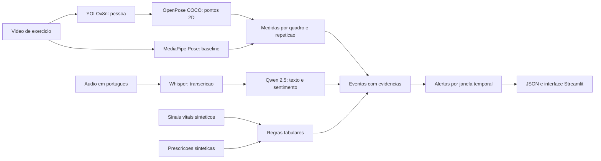

# Monitoramento multimodal experimental em fisioterapia

**Tech Challenge - Fase 4** 
**Pós-graduação em Inteligência Artificial para Desenvolvedores - FIAP POSTECH** 
**Autor:** Matheus Tomaz 
**Data:** novembro de 2026

## Entregáveis e rastreabilidade

Esta entrega reúne o código do projeto e sua demonstração audiovisual. Os acessos diretos aos artefatos estão disponíveis abaixo.

| Artefato | Localização e finalidade |
|---|---|
| Repositório de código | [Acessar o repositório da Fase 4](https://github.com/mathtmz/fiap-pos-ia-devs/tree/main/Tech%20Challenge/Fase%204) [https://github.com/mathtmz/fiap-pos-ia-devs/tree/main/Tech%20Challenge/Fase%204](https://github.com/mathtmz/fiap-pos-ia-devs/tree/main/Tech%20Challenge/Fase%204) Código-fonte, instruções técnicas, dados de avaliação e resultados computacionais. |
| Vídeo demonstrativo | [Assistir ao vídeo no YouTube](https://youtu.be/gDM1GUhGqN0) [https://youtu.be/gDM1GUhGqN0](https://youtu.be/gDM1GUhGqN0) Demonstração do processamento multimodal e da apresentação de eventos e alertas. |

## Resumo

Este trabalho descreve a implementação e a avaliação de um protótipo acadêmico de monitoramento multimodal aplicado a exercícios de fisioterapia. O fluxo integra análise de movimento em vídeo, transcrição de fala em português, extração de termos e sentimento, regras sobre séries sintéticas de sinais vitais e prescrições e organização temporal de eventos para revisão humana. A implementação utiliza OpenCV, YOLOv8n, OpenPose COCO, MediaPipe Pose, Whisper, Qwen 2.5 e Streamlit.

A avaliação de transcrição comparou os modelos Whisper `tiny`, `base` e `small` em duas consultas sintéticas com 148 palavras de referência. O WER agregado foi de 9,46%, 6,76% e 0%, respectivamente. Em 30 frases sintéticas, o Qwen obteve F1 macro de sentimento de 0,6067. Na avaliação visual de 556 repetições do conjunto REHAB26-ViewAngles, OpenPose/YOLO avaliou 60 casos (10,79% de cobertura), com F1 micro de 0,7959 entre esses casos; 496 repetições foram classificadas como inconclusivas. MediaPipe avaliou 406 repetições (73,02%), com F1 micro de 0,6538. Os cenários tabulares sintéticos produziram zero eventos no caso normal e cinco eventos agrupados em dois alertas no caso anômalo. A demonstração integrada reuniu oito eventos em dois alertas e preservou a proveniência das evidências.

Os resultados caracterizam experimentos controlados e demonstrativos. Fontes de vídeo, áudio e tabelas são independentes e foram associadas artificialmente para avaliar a integração; as métricas devem ser interpretadas de acordo com os dados e a cobertura observados.

**Palavras-chave:** fisioterapia; análise multimodal; visão computacional; reconhecimento de fala; detecção de anomalias; rastreabilidade.

## 1. Introdução

A reabilitação física envolve observações distribuídas entre movimento, relatos verbais, registros de sinais vitais e prescrições. A organização conjunta dessas informações pode apoiar a revisão de uma sessão ao tornar eventos relevantes e suas evidências mais fáceis de localizar. A análise de vídeo pode estimar pontos corporais e medidas de movimento; o processamento de fala pode transformar áudio em segmentos textuais; e regras sobre dados tabulares podem destacar valores ou alterações a serem revisadas.

Este trabalho desenvolve um protótipo experimental para investigar esse fluxo de ponta a ponta. O escopo é delimitado ao exercício de abdução do braço em vídeo, a consultas sintéticas em português e a cenários tabulares sintéticos de sinais vitais e prescrições. Dois materiais audiovisuais públicos em português relacionados à fisioterapia também foram processados e descritos por métricas operacionais. A proveniência dos conjuntos e dos materiais externos está organizada no manifesto do projeto [1].

A contribuição central é a integração rastreável: cada evento preserva modalidade, instante, evidência, regra ou modelo e arquivo de origem. Os eventos são reunidos por caso e janela temporal e apresentados em relatórios JSON e em uma interface Streamlit. O sistema é apresentado como protótipo acadêmico de apoio à revisão humana.

### 1.1 Objetivo geral

Implementar e avaliar um fluxo reproduzível que analise vídeo, áudio e registros tabulares, associe evidências por caso e apresente eventos temporais para revisão humana.

### 1.2 Objetivos específicos

- Extrair medidas de movimento a partir de pontos corporais estimados em vídeo e comparar os resultados com anotações de repetições.
- Comparar configurações de transcrição automática em português por meio de WER, tempo e memória observados.
- Avaliar extração textual, sentimento e encaminhamento para revisão em frases sintéticas rotuladas.
- Aplicar regras explícitas a séries sintéticas de sinais vitais e prescrições.
- Preservar origem e tempo dos eventos, reuni-los em alertas e demonstrar sua inspeção em interface local.

## 2. Metodologia

### 2.1 Delineamento experimental e fontes de dados

O estudo tem caráter aplicado e experimental. As análises foram conduzidas em três grupos de dados independentes:

| Grupo | Dados usados | Uso na avaliação |
|---|---|---|
| Movimento | REHAB26-ViewAngles, exercício 1 (abdução do braço), cinco participantes e 556 repetições anotadas [2] | Estimar características de pose e avaliar regras por participante e tipo de erro |
| Áudio e texto com referência | OAW01 e OAW04, consultas roteirizadas e sintetizadas em português; 148 palavras de referência [3] | Comparar WER do Whisper, VAD e agrupamento exploratório de locutores |
| Texto rotulado | 30 frases sintéticas em português | Avaliar sentimento, termos e encaminhamento para alerta ou revisão |
| Sinais e prescrições | Arquivos CSV sintéticos do projeto | Verificar regras em cenários normal e anômalo |
| Materiais públicos de áudio | Dois vídeos públicos em português relacionados a atendimentos de fisioterapia [13, 14] | Processar fala e registrar medidas descritivas de duração, segmentos, palavras e tempo |

Os conjuntos têm objetivos distintos. Os materiais não representam uma única sessão ou pessoa; o identificador comum de demonstração é usado para testar a integração técnica. Os dados tabulares e as frases sintéticas são entradas artificiais criadas para avaliação do comportamento do código.

### 2.2 Arquitetura do protótipo

A arquitetura organiza as modalidades em processadores independentes. Cada processador pode retornar estado, duração, dados derivados e eventos. O pipeline reúne os resultados disponíveis, calcula alertas por janelas de 30 segundos e salva um relatório estruturado. A interface permite carregar arquivos e inspecionar as evidências.

**Figura 1 -** Arquitetura do fluxo multimodal implementado. Os dados de entrada mantêm fontes independentes e são associados por identificador apenas para a demonstração.

### 2.3 Análise de vídeo e movimento

O OpenCV lê os vídeos, seleciona quadros nos instantes configurados e mantém o índice do quadro e o tempo de origem. YOLOv8n localiza objetos de categorias gerais e seleciona a pessoa principal. A região correspondente é encaminhada ao OpenPose COCO por meio do módulo DNN do OpenCV, que produz mapas de confiança para pontos corporais bidimensionais [4, 5]. O sistema utiliza os máximos desses mapas para estimar as coordenadas das articulações.

A partir dos pontos, são calculadas medidas experimentais: ângulo do braço em relação ao tronco, ângulo do cotovelo, elevação relativa do ombro, inclinação da cabeça e uma razão lateral projetada. MediaPipe Pose é executado como baseline de pontos corporais [6]. Uma repetição requer ao menos duas amostras de pose válidas para ser classificada; quando essa condição não é satisfeita, sua situação é registrada como inconclusiva.

A avaliação principal utiliza as 556 repetições anotadas do exercício 1 do REHAB26-ViewAngles. A frequência de amostragem é de 0,5 quadro por segundo. A validação segue o esquema leave-one-participant-out: em cada uma das cinco dobras, quatro participantes são usados para ajustar limiares e o participante restante é reservado para teste. As características são confrontadas com rótulos de execução correta e cinco categorias de erro: amplitude insuficiente, cotovelo flexionado, ombro elevado, inclinação da cabeça e braço fora do plano. Um ensaio exploratório independente com o REHAB24-6 verificou regras geométricas em gravações adicionais [12].

### 2.4 Processamento de áudio e texto

Os arquivos de áudio são convertidos para canal mono e frequência de 16 kHz antes da análise. O Whisper é configurado para português e comparado nos tamanhos `tiny`, `base` e `small` [7]. O WER é calculado por:

**WER = (substituições + omissões + inserções) / número de palavras da referência.**

A normalização converte o texto para minúsculas e remove a pontuação durante a comparação. Tempo de execução e memória de pico também são registrados. A análise do VAD compara o mesmo áudio com e sem segmentação prévia de fala.

Na etapa textual, o Qwen2.5-0.5B-Instruct recebe segmentos da transcrição e produz uma estrutura com sentimento e termos candidatos [8]. O código verifica se os termos retornados aparecem literalmente na frase e se pertencem ao vocabulário permitido. Frases interrogativas ou com negação são direcionadas a revisão humana. Os trechos mantêm os tempos de origem da transcrição.

O processamento acústico calcula duração, proporção de quadros silenciosos e palavras por minuto. As medidas usam quadros de 30 ms e uma referência de energia derivada do nível do áudio. Uma regra exploratória marca combinações de ritmo inferior a 80 palavras por minuto e mais de 50% de quadros silenciosos para revisão. Esses descritores são apresentados como características do sinal, sem atribuir causa clínica.

O agrupamento de locutores usa coeficientes MFCC, normalização das características e K-means com dois grupos. Os identificadores resultantes são `locutor_1` e `locutor_2`; a associação a papéis como profissional ou paciente depende de revisão humana.

### 2.5 Regras para séries tabulares

As séries de sinais vitais e prescrições são lidas de arquivos CSV. A tabela a seguir apresenta os limites experimentais configurados no cenário sintético:

| Variável | Unidade | Intervalo usado pelo protótipo |
|---|---|---:|
| Frequência cardíaca | bpm | 50 a 120 |
| Pressão sistólica | mmHg | 90 a 160 |
| Pressão diastólica | mmHg | 50 a 100 |
| Saturação periférica de oxigênio (SpO2) | % | 92 a 100 |

Os intervalos são parâmetros experimentais definidos para os CSVs sintéticos e não constituem faixas clínicas recomendadas. Um valor fora do intervalo produz evento com instante, variável, evidência numérica, regra e arquivo de origem. Para prescrições, o código compara registros consecutivos do mesmo medicamento. Uma variação relativa de dose igual ou superior a 50% gera evento; uma alteração de unidade também gera evento e é encaminhada para revisão sem comparação numérica entre unidades diferentes.

### 2.6 Eventos, alertas e interface

Cada evento contém identificador do caso, tempo em segundos, modalidade, tipo, evidência, regra, arquivo de origem, modelo, quadro quando aplicável, confiança quando disponível e estado de revisão. O identificador do evento é derivado de campos do próprio registro para permitir rastreabilidade.

A fusão agrupa eventos do mesmo caso em janelas consecutivas de 30 segundos. A aplicação Streamlit chama o pipeline, apresenta o estado de cada modalidade, mostra transcrição e vídeo anotado quando existem, lista eventos e alertas e permite baixar o relatório JSON. A reprodução a 1x ordena temporalmente eventos já calculados e mede o atraso de apresentação desses registros.

### 2.7 Métricas de avaliação

A comparação de transcrição usa WER, tempo e memória observados. As avaliações de texto e movimento utilizam precisão, recall e F1. Para movimento, a cobertura é reportada como a proporção de repetições em que houve dados suficientes para avaliação. Os cenários tabulares são avaliados pela correspondência entre os valores construídos e os eventos produzidos. Na integração, registram-se contagem de eventos e alertas, duração de processamento e latência da reprodução temporal.

## 3. Resultados

### 3.1 Reconhecimento de fala

Nas duas consultas sintéticas, totalizando 148 palavras de referência, o tamanho `small` teve menor WER, seguido de `base` e `tiny`.

| Modelo Whisper | Erros / palavras | WER | Tempo total | Memória de pico média |
|---|---:|---:|---:|---:|
| `tiny` | 14 / 148 | 9,46% | 4,275 s | 577,2 MiB |
| `base` | 10 / 148 | 6,76% | 6,395 s | 815,9 MiB |
| `small` | 0 / 148 | 0% | 14,434 s | 2.165,6 MiB |

O resultado orientou a seleção de `small` como configuração padrão da demonstração. Em OAW04, o WER com VAD foi 80,77%, comparado a 15,38% sem VAD. Na amostra avaliada, a segmentação automática de fala reduziu o conteúdo transcrito de forma desfavorável.

Nos dois materiais públicos em português relacionados à fisioterapia, os registros de processamento apresentam respectivamente 5.075 palavras em 2.467,35 segundos de mídia, com execução de 75,287 segundos, e 151 palavras em 287,15 segundos, com execução de 20,437 segundos. Esses indicadores descrevem a execução e a quantidade de segmentos produzidos.

### 3.2 Análise textual e agrupamento de locutores

Em 30 frases sintéticas, o Qwen obteve acurácia de sentimento de 0,6333 e F1 macro de 0,6067. O F1 de encaminhamento para alerta foi 0,9231 e o de encaminhamento para revisão humana foi 0,9000.

| Categoria de termo | Precisão | Recall | F1 |
|---|---:|---:|---:|
| Dor | 1,000 | 0,846 | 0,917 |
| Cansaço | 1,000 | 0,900 | 0,947 |
| Falta de ar | 1,000 | 0,714 | 0,833 |

As métricas refletem frases curtas e rotuladas para o experimento. A preservação do trecho literal permite inspecionar a origem do termo, e perguntas e negações seguem para revisão. Na avaliação exploratória de diarização de OAW04, 78 palavras foram alinhadas a dois agrupamentos acústicos. A acurácia de atribuição foi 1,0 após escolher, com base na referência, o melhor mapeamento entre os dois grupos. O valor descreve esse ensaio e esse procedimento de alinhamento.

### 3.3 Avaliação de movimento

A avaliação do REHAB26 abrangeu 556 repetições de cinco participantes. Foram amostrados 926 quadros e 256 deles produziram pose suficiente para extrair pontos válidos. A comparação agregada por método foi:

| Método | Avaliadas | Cobertura | VP | FP | FN | VN |
|---|---:|---:|---:|---:|---:|---:|
| OpenPose + YOLOv8n | 60 / 556 | 10,79% | 39 | 20 | 0 | 1 |
| MediaPipe Pose | 406 / 556 | 73,02% | 187 | 184 | 14 | 21 |

| Método | Precisão | Recall | F1 micro |
|---|---:|---:|---:|
| OpenPose + YOLOv8n | 0,661 | 1,000 | 0,7959 |
| MediaPipe Pose | 0,504 | 0,930 | 0,6538 |

A métrica binária de OpenPose/YOLO foi calculada nas 60 repetições avaliáveis; as outras 496 ficaram inconclusivas. A média de F1 binário entre as cinco dobras foi 0,8108. Para as cinco categorias específicas de erro, o F1 macro médio foi 0,1776. Os F1 micro por classe foram 0,222 para amplitude insuficiente, 0,161 para cotovelo flexionado, 0,119 para ombro elevado, 0,276 para inclinação da cabeça e 0,298 para braço fora do plano. A cobertura dessas características variou de 17,45% a 34,53%.

Nos cinco clipes curtos de demonstração com erro rotulado, as regras visuais não produziram eventos; o clipe normal também resultou em zero eventos. A inferência temporal teve mediana aproximada de 2,35 segundos por quadro amostrado e percentil 95 entre 2,36 e 2,37 segundos. A validação completa por participante, repetição e classe está registrada no arquivo de avaliação visual [9].

### 3.4 Ensaio exploratório no REHAB24-6

No participante PM001, duas repetições foram examinadas: uma execução correta e uma incorreta. A regra geométrica inicial classificou ambas como sem desvio. Em seguida, seis repetições do participante PM101 foram processadas, uma rotulada como correta e cinco como incorretas; a regra inicial também não emitiu eventos para esses seis trechos.

Em uma calibração exploratória, o limiar `max_angle < 132.35` foi ajustado aos dois exemplos de PM001 e aplicado às seis repetições de PM101. O resultado foi VP=1, FP=0, FN=4 e VN=1, com recall de 0,20, precisão de 1,00 e F1 de 0,333. O valor de precisão decorre da ausência de falsos positivos nessa pequena amostra; quatro das cinco repetições incorretas não foram sinalizadas. O ensaio documenta a sensibilidade do resultado à calibração e à variedade dos exemplos, em complemento à avaliação principal por participante.

### 3.5 Dados tabulares e integração multimodal

O cenário normal com sinais vitais e prescrições sintéticos produziu zero eventos e zero alertas. No cenário anômalo tabular, foram gerados cinco eventos: três de sinais vitais (frequência cardíaca de 130 bpm, pressão sistólica de 165 mmHg e SpO2 de 91%) e dois de prescrição (variação de dose de 10 para 20 mg e alteração de unidade de mg para mcg). Esses eventos foram agrupados em dois alertas por janela temporal.

Na demonstração integrada, oito eventos de vídeo, texto, sinais vitais e prescrições foram reunidos em dois alertas. O processamento registrado durou 22,569 segundos. O evento visual do exemplo aponta para o arquivo `low_abduction.mp4`, quadro 21, e identifica MediaPipe Pose; os demais eventos preservam seus arquivos de origem. A associação temporal foi feita para demonstrar o fluxo do protótipo.

Na reprodução dos eventos pré-calculados a 1x, os oito eventos foram entregues na ordem temporal. A latência mediana de apresentação foi 9,879 ms e o percentil 95 foi 10,508 ms. Essa medida corresponde à entrega temporizada dos eventos existentes no relatório e não ao tempo de processamento de áudio ou vídeo.

## 4. Discussão

A comparação do Whisper mostra a relação entre qualidade observada e custo computacional dentro das amostras utilizadas. O modelo `small` obteve WER zero nas duas consultas roteirizadas, com tempo e memória maiores que `base` e `tiny`. O contraste do VAD em OAW04 demonstra que uma etapa de pré-processamento pode alterar substancialmente a transcrição, e que sua utilidade depende do sinal e da configuração avaliados.

Na análise textual, os indicadores de encaminhamento são superiores ao F1 macro de sentimento, mas ambos refletem um conjunto sintético de 30 frases. A inspeção do trecho literal e o encaminhamento de perguntas e negações mantêm os achados associados ao contexto que os originou. O ensaio de locutores aplica MFCC e agrupamento em duas classes; como o mapeamento é comparado posteriormente com a referência, sua acurácia deve ser entendida no contexto desse experimento.

O resultado visual exige leitura conjunta de F1 e cobertura. OpenPose/YOLO teve F1 micro de 0,7959 nos casos avaliáveis, porém gerou saída avaliável em 10,79% das repetições. MediaPipe teve cobertura superior e mais falsos positivos. A avaliação por classes e os clipes demonstrativos mostram que as regras geométricas ainda variam conforme a visibilidade dos pontos, o ângulo de câmera e a forma como o erro é representado em duas dimensões. O F1 isolado não resume esse comportamento.

Os cenários tabulares confirmam que as regras geram eventos para as condições explicitamente inseridas nos CSVs. A integração preserva a origem das evidências e organiza os instantes em janelas de alerta. Como as fontes são independentes e a reprodução temporal ocorre sobre eventos previamente calculados, os resultados caracterizam a integração de software e a apresentação das evidências em um cenário controlado.

Em conjunto, os experimentos demonstram o percurso técnico desde a leitura dos arquivos até a apresentação de alertas rastreáveis. As métricas devem ser relacionadas aos tamanhos, rótulos e condições dos conjuntos usados; elas descrevem o protótipo nas avaliações conduzidas.

## 5. Conclusão

O trabalho implementou um fluxo acadêmico multimodal para análise experimental de movimento, áudio, texto, sinais vitais e prescrições. OpenCV, YOLOv8n, OpenPose COCO e MediaPipe foram usados na avaliação visual; Whisper e Qwen foram aplicados ao processamento de fala e texto; regras explícitas trataram os dados tabulares sintéticos. O pipeline reuniu os resultados em eventos, alertas e relatórios, e a interface Streamlit permitiu inspecionar as evidências.

A avaliação produziu comparações quantitativas de WER, tempo, memória, métricas de classificação, cobertura visual e latência de reprodução. Os resultados mais relevantes foram a escolha experimental do Whisper `small` nas referências sintéticas, a baixa cobertura visual de OpenPose/YOLO, a maior cobertura do baseline MediaPipe e a execução consistente das regras nos cenários tabulares conhecidos. A rastreabilidade de fonte e tempo possibilita revisar cada achado dentro do escopo demonstrado.

O estudo consolida uma implementação reproduzível e uma avaliação transparente das condições em que cada componente foi executado. A interpretação do protótipo permanece vinculada aos dados e métricas apresentados neste relatório.

## Referências

[1] MATHEUS TOMAZ. *Tech Challenge Fase 4: fontes e dados do projeto*. 2026. Arquivo `FONTES_DADOS.md`. Fontes dos vídeos de exercício, consultas sintéticas, materiais audiovisuais públicos e pesos externos.

[2] JÁNOŠOVÁ, M.; LANG, A.; BUDIKOVA, P.; SEDMIDUBSKY, J. *Impact of Patient Orientation in Single- and Multi-View Camera Environments for AI-based Rehabilitation Monitoring*. arXiv, 2026. DOI: <https://doi.org/10.48550/arXiv.2609.35726>. Conjunto REHAB26-ViewAngles, Zenodo, DOI: <https://doi.org/10.5281/zenodo.23018128>.

[3] BARBOSA, A. *FIAP Module 04 Fake Consultation*. Hugging Face Datasets, licença MIT informada no cartão do conjunto. Disponível em: <https://huggingface.co/datasets/ana-barbosa/fiap-module-04-fake-consultation>.

[4] CAO, Z.; SIMON, T.; WEI, S.-E.; SHEIKH, Y. Realtime Multi-Person 2D Pose Estimation Using Part Affinity Fields. In: *Proceedings of the IEEE Conference on Computer Vision and Pattern Recognition*, 2017, p. 7291-7299. Disponível em: <https://openaccess.thecvf.com/content_cvpr_2017/html/Cao_Realtime_Multi-Person_2D_Pose_Estimation_Using_Part_Affinity_Fields_CVPR_2017_paper.html>.

[5] ULTRALYTICS. *YOLOv8*. Documentação do modelo. Disponível em: <https://docs.ultralytics.com/models/yolov8/>.

[6] GOOGLE. *MediaPipe Pose Landmarker*. Documentação oficial. Disponível em: <https://developers.google.com/edge/mediapipe/solutions/vision/pose_landmarker>.

[7] RADFORD, A. et al. Robust Speech Recognition via Large-Scale Weak Supervision. arXiv, 2022. Disponível em: <https://arxiv.org/abs/2212.04356>. Implementação: <https://github.com/openai/whisper>.

[8] QWEN TEAM. Qwen2.5 Technical Report. arXiv, 2024. Disponível em: <https://arxiv.org/abs/2412.15115>. Modelo Qwen2.5-0.5B-Instruct: <https://huggingface.co/Qwen/Qwen2.5-0.5B-Instruct>.

[9] MATHEUS TOMAZ. *Avaliação leave-one-participant-out do REHAB26-ViewAngles*. 2026. Arquivo de resultados: `docs/resultados/rehab26_lopo.json`.

[10] OPEN SOURCE COMPUTER VISION LIBRARY. *OpenCV Documentation*. Disponível em: <https://docs.opencv.org/>.

[11] STREAMLIT. *Streamlit Documentation*. Disponível em: <https://docs.streamlit.io/>.

[12] ČERNEK, A. et al. *REHAB24-6: A multi-modal dataset of physical rehabilitation exercises*. Zenodo, 2024. DOI: <https://doi.org/10.5281/zenodo.13305826>.

[13] SITTA, R. *A terapia manual na prática! (ao vivo)*. YouTube, 4 nov. 2022. Disponível em: <https://www.youtube.com/watch?v=Y3Au3GcBbbg>.

[14] SITTA, R. *Artroplastia de quadril: fisioterapia e recuperação no pós-operatório*. YouTube. Disponível em: <https://www.youtube.com/watch?v=ihY3hJ9-RBg>.
