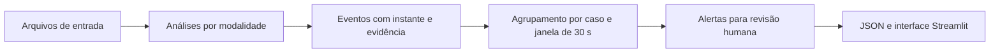

# Tutorial de estudo: entenda o projeto e prepare sua apresentação

Este material foi escrito para estudar o trabalho desde o começo, mesmo sem ter acompanhado a implementação. A meta não é decorar siglas: é conseguir explicar, com as próprias palavras, **qual problema o grupo escolheu, o que o código faz, que evidências produziu e o que os resultados não permitem afirmar**.

Use este tutorial em sessões curtas. Leia uma etapa, abra os arquivos indicados, execute o exemplo correspondente quando possível e responda às perguntas sem olhar as respostas. O [passo a passo de reprodução](PASSO_A_PASSO_REPRODUCAO.md) contém as instruções completas de instalação e todos os comandos. O [roteiro de 15 minutos](../apresentacao/ROTEIRO_VIDEO.md) serve para gravar depois que você dominar o conteúdo.

## A ideia em um minuto

O projeto é um **protótipo acadêmico** que demonstra como diferentes tipos de informação poderiam ser organizados para revisão humana em um cenário de fisioterapia. Ele analisa um vídeo de exercício, transcreve áudio, procura termos em texto e aplica regras a sinais vitais e prescrições sintéticos. Cada achado vira um evento com tempo, evidência, origem e regra; eventos próximos são agrupados em alertas.

O grupo substituiu Azure Speech e Azure Text Analytics por Whisper e Qwen executados localmente, com autorização informada da instituição. As fontes não são registros de uma mesma pessoa: os vídeos de exercícios, os áudios e as tabelas sintéticas são associados artificialmente para demonstrar o fluxo. O protótipo não foi validado clinicamente, não monitora pacientes continuamente e não deve ser usado para diagnóstico ou tratamento.

Se conseguir explicar essa ideia sem ler, você já tem a estrutura da apresentação. O estudo abaixo ensina a sustentar cada parte.

## Método para estudar qualquer componente

Para cada parte, responda estas cinco perguntas:

1. **Entrada:** que arquivo ou dado entra?
2. **Transformação:** que modelo ou regra o processa?
3. **Saída:** que evento, métrica ou relatório é produzido?
4. **Evidência:** onde vejo de qual arquivo e instante veio o resultado?
5. **Limite:** o que esse resultado não prova?

Essa sequência evita apresentar uma caixa-preta e ajuda a responder perguntas da banca.

## Mapa simples do projeto

| Caminho | Em linguagem simples |
|---|---|
| [`README.md`](../../../../Tech%20Challenge/Fase%204/README.md) | Ponto de entrada: escopo, instalação e reprodução. |
| [`TECH_CHALLENGE_FASE_4.md`](../contexto/TECH_CHALLENGE_FASE_4.md) | Enunciado do desafio convertido para Markdown. |
| [`RELATORIO_FINAL_ENTREGA.md`](../relatorios/RELATORIO_FINAL_ENTREGA.md) | O que foi entregue, resultados, limitações e matriz de requisitos. |
| [`FONTES_DADOS.md`](../contexto/FONTES_DADOS.md) | De onde vieram os materiais, licenças e o que é sintético. |
| [`data/synthetic/`](../../../../Tech%20Challenge/Fase%204/data/synthetic) | CSVs de sinais e prescrições sintéticos e frases de avaliação. |
| [`code/src/fisio_fase4/analysis.py`](../../../../Tech%20Challenge/Fase%204/code/src/fisio_fase4/analysis.py) | Regras para sinais vitais, prescrições, eventos e agrupamento em alertas. |
| [`code/src/fisio_fase4/audio_text.py`](../../../../Tech%20Challenge/Fase%204/code/src/fisio_fase4/audio_text.py) | Transcrição, medidas acústicas, Qwen, termos e revisão de perguntas/negações. |
| [`code/src/fisio_fase4/video.py`](../../../../Tech%20Challenge/Fase%204/code/src/fisio_fase4/video.py) | Análise de movimento com MediaPipe e regras geométricas. |
| [`code/src/fisio_fase4/vision_models.py`](../../../../Tech%20Challenge/Fase%204/code/src/fisio_fase4/vision_models.py) | Inferência temporal com YOLOv8 e OpenPose e características corporais. |
| [`code/src/fisio_fase4/pipeline.py`](../../../../Tech%20Challenge/Fase%204/code/src/fisio_fase4/pipeline.py) | Executa modalidades, registra erros/ausências, reúne eventos e escreve relatório. |
| [`code/app.py`](../../../../Tech%20Challenge/Fase%204/code/app.py) | Interface Streamlit para enviar arquivos e inspecionar os resultados. |
| [`docs/resultados/`](../../../../Tech%20Challenge/Fase%204/docs/resultados/README.md) | Resultados e evidências versionadas que sustentam os números do trabalho. |

A ordem do fluxo é:



## Trilha de estudo

### Etapa 1 — Entenda o problema, as entregas e os dados

**Tempo sugerido:** 25 minutos.

1. Leia o [enunciado](../contexto/TECH_CHALLENGE_FASE_4.md) para saber o que foi solicitado.
2. Leia o resumo e a matriz do [relatório final](../relatorios/RELATORIO_FINAL_ENTREGA.md).
3. Leia as seções iniciais de [FONTES.md](../contexto/FONTES_DADOS.md).
4. Separe mentalmente as fontes:

| Material | O que representa | Para que serve | O que não representa |
|---|---|---|---|
| REHAB26-ViewAngles | Vídeos de cinco voluntários realizando abdução do braço, com repetições e erros anotados | Avaliar regras de movimento por participante | Pacientes hospitalizados ou diagnóstico |
| OAW01 e OAW04 | Consultas roteirizadas e sintetizadas em português, com transcrição de referência | Comparar transcrição e avaliar análise textual em amostra controlada | Conversas espontâneas de pacientes reais |
| Frases em `text_evaluation_cases.json` | 30 frases e rótulos artificiais | Comparar sentimento, termos e encaminhamento | Validação clínica da linguagem |
| CSVs de sinais vitais e prescrições | Dados sintéticos definidos pelo projeto | Verificar se as regras produzem os eventos esperados | Medições ou prescrições de pacientes |
| Vídeos públicos de consultas | Materiais que a equipe descreveu como atendimentos reais e informou ter autorização para usar | Demonstração exploratória de processamento em português | Medição de acurácia: não há transcrição humana de referência |

**Checkpoint:** explique por que não se pode dizer que todos os dados pertencem a um paciente.

**Resposta que você deve conseguir dar:** as fontes foram obtidas separadamente e não têm uma identidade ou sincronização comum. O identificador criado no caso serve para demonstrar a fusão técnica; não confirma que os dados sejam da mesma pessoa.

### Etapa 2 — Execute o primeiro exemplo e siga um evento

**Tempo sugerido:** 30–40 minutos. Não precisa baixar os modelos de vídeo para esta etapa.

Siga as seções de instalação e execução rápida do [passo a passo](PASSO_A_PASSO_REPRODUCAO.md). Com o ambiente virtual ativo, execute:

```bash
python code/scripts/reproduce.py --quick
```

Esse comando verifica o ambiente, executa os testes e cria um cenário normal e um anômalo usando tabelas sintéticas. Depois, abra os relatórios:

```bash
python -m json.tool docs/resultados/reproduction_quick_normal.json
python -m json.tool docs/resultados/reproduction_quick_anomaly.json
```

O caso normal tem **0 eventos e 0 alertas**. O anômalo tem **5 eventos e 2 alertas**. No relatório anômalo, encontre as chaves `modalities`, `events` e `alerts`.

Agora abra [`analysis.py`](../../../../Tech%20Challenge/Fase%204/code/src/fisio_fase4/analysis.py) e encontre:

- `LIMITS`: os limites experimentais de sinais vitais;
- `detect_vitals`: cria um evento se um valor ficar fora do limite configurado;
- `detect_prescriptions`: compara registros consecutivos do mesmo medicamento;
- `event`: padroniza os campos e cria um identificador;
- `fuse_events`: agrupa eventos do mesmo caso em blocos de 30 segundos.

No caso anômalo aparecem:

- frequência cardíaca de 130 bpm;
- pressão sistólica de 165 mmHg;
- SpO₂ de 91%;
- dose alterada de 10 para 20 mg;
- unidade alterada de mg para mcg.

Os eventos de 20 segundos entram na janela de 0–30 s; os de 30 e 40 segundos entram na janela de 30–60 s. Daí resultam dois alertas. Os limites [50, 120] bpm, [90, 160] mmHg, [50, 100] mmHg e [92, 100]% são parâmetros didáticos usados no protótipo, não recomendações clínicas. Uma variação relativa de dose de pelo menos 50% gera evento; mudança de unidade também exige revisão e não é comparada numericamente.

**Exercício:** escolha um evento no JSON e explique cada campo: `time_s`, `modality`, `kind`, `evidence`, `rule`, `source` e `review_status`.

**Checkpoint:** por que cinco eventos viraram dois alertas?

**Resposta esperada:** o agrupador coloca eventos do mesmo caso em janelas consecutivas de 30 segundos. Eventos na mesma janela aparecem juntos no alerta. O agrupamento organiza revisão; não confirma que as anomalias tenham uma causa comum.

### Etapa 3 — Entenda o áudio e o texto

**Tempo sugerido:** 40 minutos.

Leia [`audio_text.py`](../../../../Tech%20Challenge/Fase%204/code/src/fisio_fase4/audio_text.py) e examine estes resultados:

- [`whisper_comparacao.json`](../../../../Tech%20Challenge/Fase%204/docs/resultados/whisper_comparacao.json)
- [`vad_comparacao.json`](../../../../Tech%20Challenge/Fase%204/docs/resultados/vad_comparacao.json)
- [`text_evaluation.json`](../../../../Tech%20Challenge/Fase%204/docs/resultados/text_evaluation.json)
- [`diarizacao_sintetica.json`](../../../../Tech%20Challenge/Fase%204/docs/resultados/diarizacao_sintetica.json)

O fluxo de áudio funciona assim:

1. O pipeline converte o arquivo para mono e 16 kHz.
2. Whisper `small`, em português, produz transcrição e segmentos com tempos.
3. São calculados descritores como duração, proporção de quadros silenciosos e palavras por minuto.
4. Qwen recebe trechos de texto e propõe sentimento e termos.
5. O código confere se o termo retornado aparece literalmente no trecho e se pertence à lista permitida.
6. Menções em perguntas ou frases com termos como “não”, “sem” ou “nega” são encaminhadas para revisão humana em vez de tratadas automaticamente como alerta afirmativo.

#### O que significa WER?

WER é a taxa de erro de palavras. O cálculo soma substituições, omissões e inserções e divide pela quantidade de palavras da referência:

`WER = (substituições + omissões + inserções) / palavras da referência`

A avaliação normaliza maiúsculas/minúsculas e remove pontuação antes de comparar. Nas duas consultas sintéticas, com 148 palavras de referência:

| Modelo | WER medido | Tempo total medido |
|---|---:|---:|
| Whisper `tiny` | 9,46% | 4,275 s |
| Whisper `base` | 6,76% | 6,395 s |
| Whisper `small` | 0% | 14,434 s |

O grupo escolheu `small` como padrão porque teve o menor WER **nessa pequena amostra**, apesar do maior tempo e uso de memória. Não diga “Whisper small tem 100% de acurácia” como afirmação geral. Diga “não houve erro de palavra nas duas consultas sintéticas avaliadas”.

O VAD deveria separar fala de silêncio, mas no ensaio de OAW04 o WER passou de 15,38% sem VAD para 80,77% com VAD. Por isso permanece desligado por padrão. Isso mostra que uma técnica que parece útil pode piorar o resultado em uma amostra concreta.

Em 30 frases sintéticas, o Qwen teve F1 macro de sentimento 0,6067, F1 de encaminhamento a alertas 0,9231 e F1 para revisão humana 0,9000. Houve erros e falsos negativos. Pausas e velocidade de fala são somente descritores: não há dados rotulados que validem detecção de fadiga, disartria ou falta de ar.

**Checkpoint:** o que prova o WER 0% do Whisper `small`? E o que não prova?

**Resposta esperada:** prova que, após a normalização usada, a transcrição coincidiu com as referências das duas consultas sintéticas avaliadas. Não prova desempenho em consultas espontâneas, outras vozes ou população clínica.

### Etapa 4 — Entenda os modelos de visão e os números

**Tempo sugerido:** 50–70 minutos. Esta etapa fica mais clara com os vídeos de demonstração, mas pode ser estudada pelos resumos JSON sem baixar os vídeos completos.

Leia [`vision_models.py`](../../../../Tech%20Challenge/Fase%204/code/src/fisio_fase4/vision_models.py), [`video.py`](../../../../Tech%20Challenge/Fase%204/code/src/fisio_fase4/video.py), o avaliador [`evaluate_rehab26.py`](../../../../Tech%20Challenge/Fase%204/code/scripts/evaluate_rehab26.py) e [`rehab26_lopo.json`](../../../../Tech%20Challenge/Fase%204/docs/resultados/rehab26_lopo.json).

Em palavras simples:

1. OpenCV abre o vídeo e seleciona quadros em intervalos configurados.
2. YOLOv8n procura objetos de classes gerais e seleciona uma caixa de pessoa.
3. OpenPose COCO estima pontos corporais 2D dentro da região selecionada.
4. O código calcula medidas geométricas aproximadas, como ângulo do braço, flexão do cotovelo, elevação relativa do ombro, inclinação da cabeça e posição lateral do punho.
5. As medidas de cada repetição são comparadas com limiares experimentais; com pontos insuficientes, a repetição fica inconclusiva.
6. MediaPipe fornece uma comparação independente (baseline).

As anotações do REHAB26 fornecem os limites de cada repetição e cinco tipos de erro. A avaliação **leave-one-participant-out** retém uma pessoa para teste e usa as outras quatro para ajustar limiares; repete isso até que cada uma das cinco pessoas tenha sido retida uma vez. Assim, os quadros de uma mesma pessoa não ficam misturados entre o ajuste e o teste daquela dobra.

#### Leia cobertura antes do F1

Para OpenPose/YOLO:

- total: 556 repetições;
- avaliáveis: 60, ou 10,79%;
- inconclusivas: 496;
- nos 60 avaliáveis: 39 verdadeiros positivos, 20 falsos positivos, 0 falsos negativos e 1 verdadeiro negativo;
- F1 micro nesses casos: 0,7959.

A cobertura responde “em quantos casos o sistema conseguiu dar uma saída avaliável?”. O F1 responde sobre o equilíbrio entre precisão e recall **apenas nos casos avaliados**. Como 496 repetições ficaram de fora, não apresente 0,7959 isoladamente como desempenho do sistema.

Como referência, MediaPipe avaliou 406 de 556 repetições (73,02%) e teve F1 micro 0,6538, com 187 verdadeiros positivos, 184 falsos positivos, 14 falsos negativos e 21 verdadeiros negativos. O resultado mostra uma troca entre cobertura e métrica nos dados avaliados, não uma superioridade clínica.

O F1 macro médio por tipo de erro foi 0,1776. Além disso, os cinco clipes curtos com erro rotulado no índice de exemplos geraram zero eventos. Esse é um achado negativo importante: a versão atual tem limites reais de detecção. YOLOv8n detecta categorias gerais; não é um detector de lesão ou de “área crítica hospitalar”. OpenPose produz pontos em 2D; não recupera profundidade.

**Checkpoint:** por que é incorreto dizer simplesmente “OpenPose/YOLO atingiu F1 de 0,80 e funciona bem”?

**Resposta esperada:** porque o resultado vem de apenas 60 das 556 repetições (10,79% de cobertura), contém 20 falsos positivos e não detectou erros nos cinco clipes de demonstração. F1 sem cobertura e contexto omite uma limitação central.

### Etapa 5 — Entenda integração, falhas e interface

**Tempo sugerido:** 35 minutos.

Abra [`pipeline.py`](../../../../Tech%20Challenge/Fase%204/code/src/fisio_fase4/pipeline.py). A função central é `run_case`. Ela chama cada modalidade separadamente, registra seu estado como `ok`, `ausente` ou `erro`, agrega os eventos disponíveis e grava um `relatorio.json`. Um erro em uma modalidade não apaga automaticamente o resultado das outras.

Depois, veja [`replay.py`](../../../../Tech%20Challenge/Fase%204/code/src/fisio_fase4/replay.py). Ele ordena eventos pelo instante e agenda sua apresentação. A execução integrada registrada gerou oito eventos (um de vídeo, dois de texto, três de sinais vitais e dois de prescrições), agrupados em dois alertas em 22,569 segundos. A reprodução a 1× entregou oito eventos com mediana de 9,879 ms e P95 de 10,508 ms.

A distinção que você precisa explicar é:

- **22,569 s:** tempo registrado para executar o caso integrado.
- **9,879 ms de mediana / 10,508 ms de P95:** atraso ao apresentar eventos já calculados em sequência.
- **Não medido:** um serviço que receba continuamente vídeo e áudio, analise tudo ao vivo e notifique uma equipe clínica.

Na interface [`app.py`](../../../../Tech%20Challenge/Fase%204/code/app.py), o usuário pode carregar vídeo, áudio, CSVs e marcar o uso dos CSVs sintéticos. O botão “Processar caso” chama `run_case`. A tela mostra estado das modalidades, transcrição, vídeo anotado, eventos, alertas e permite baixar o JSON. O botão de reprodução mostra eventos calculados em seus instantes, não inferência ao vivo.

**Checkpoint:** a reprodução temporal prova que o sistema funciona em tempo real?

**Resposta esperada:** não. Ela prova que eventos pré-calculados podem ser apresentados em ordem temporal. Áudio e vídeo foram processados em lote antes da reprodução.

### Etapa 6 — Prepare-se para explicar limites e escolhas

**Tempo sugerido:** 30 minutos.

Memorize estas distinções, mas explique-as com suas palavras:

- **Requisito oficial:** o que está pedido no enunciado.
- **Substituição autorizada:** Azure foi trocado por Whisper e Qwen locais, conforme autorização informada pela equipe.
- **Implementação:** o código realmente executa análise de vídeo, áudio/texto, regras tabulares, fusão e interface.
- **Evidência:** JSONs, métricas, exemplos anotados, testes e relatórios no repositório.
- **Limitação:** dados pequenos/sintéticos, baixo alcance visual, sem rótulos clínicos de voz, associação artificial, inferência em lote e sem validação clínica.

**Não diga:**

- “O sistema diagnostica fadiga, disartria, falta de ar ou lesão.”
- “Os vídeos e áudios são todos do mesmo paciente.”
- “O alerta foi entregue a uma equipe hospitalar.”
- “O protótipo opera em tempo real.”
- “F1 0,7959 significa que a análise visual está validada.”
- “O WER 0% prova transcrição perfeita em português.”

**Prefira dizer:**

- “O sistema gera achados experimentais para revisão humana.”
- “A integração usa fontes independentes, associadas artificialmente para a demonstração.”
- “A reprodução temporal agenda eventos que já foram calculados.”
- “O F1 0,7959 se refere a 60 repetições avaliáveis; a cobertura foi 10,79%.”
- “WER 0% ocorreu em duas consultas sintéticas roteirizadas, não em consultas reais.”

## Glossário para a banca

| Termo | Explicação direta |
|---|---|
| Evento | Um achado individual com instante, tipo, evidência, regra/modelo e origem. |
| Alerta | Um ou mais eventos organizados em uma janela temporal para revisão. |
| Sintético | Criado artificialmente para testar o programa; não é registro de paciente. |
| WER | Erros de palavra divididos pelo total de palavras da referência. Quanto menor, melhor para aquela amostra. |
| Precisão | Entre os casos que o sistema sinalizou, quantos estavam rotulados como positivos. |
| Recall | Entre os positivos rotulados, quantos o sistema encontrou. |
| F1 | Média harmônica entre precisão e recall; deve ser lida junto à cobertura e aos rótulos usados. |
| Cobertura | Fração dos casos em que o método conseguiu produzir uma predição avaliável. |
| Baseline | Método de referência usado para comparar outro método; aqui, MediaPipe na avaliação visual. |
| LOPO | Leave-one-participant-out: uma pessoa é reservada para teste enquanto as demais ajustam limiares. |
| Inconclusivo | Não há pontos ou amostras suficientes para avaliar; não significa “movimento correto”. |
| VAD | Detecção de trechos com fala. No experimento feito, ligá-lo piorou o WER em OAW04. |
| Diarização | Agrupar trechos de fala por locutor; o agrupamento não identifica automaticamente profissão ou identidade. |
| Lote | Processar um arquivo completo ou trecho e só depois apresentar o resultado. |
| Latência de reprodução | Atraso ao entregar evento já calculado; não inclui o custo total de analisar mídia. |

## Roteiro de estudo em cinco sessões

É possível fazer em dias diferentes. Se houver pouco tempo, faça pelo menos as sessões 1, 2, 4 e 5 e consulte os artefatos já versionados para áudio e vídeo.

| Sessão | Estudo | Resultado esperado |
|---|---|---|
| 1 — Visão geral (30–40 min) | Enunciado, resumo, fontes e mapa dos arquivos. | Explicar o projeto em um minuto e distinguir os tipos de dados. |
| 2 — Regras e JSON (40 min) | Percurso rápido; `analysis.py`; comparar caso normal e anômalo. | Seguir um valor da entrada até evento e alerta. |
| 3 — Áudio/texto (40–50 min) | `audio_text.py`; resultados Whisper, VAD, Qwen e diarização. | Explicar WER, escolha do modelo e limites dos rótulos sintéticos. |
| 4 — Visão (50–70 min) | `vision_models.py`, `video.py`, `evaluate_rehab26.py`, JSON final. | Explicar a cobertura baixa e não exagerar o F1. |
| 5 — Integração e ensaio (40 min) | `pipeline.py`, `replay.py`, interface e roteiro de 15 minutos. | Responder perguntas sobre alertas, tempo real e limitações. |

## Simulado de perguntas da banca

Tente responder em voz alta antes de consultar as respostas.

<details>
<summary>Por que usar Whisper e Qwen em vez de Azure?</summary>

A instituição autorizou a substituição, conforme informado pela equipe. Whisper executa a transcrição e Qwen a análise textual localmente. O projeto não faz chamadas Azure nem depende de credenciais desses serviços.
</details>

<details>
<summary>Por que escolher Whisper small se é mais lento?</summary>

Na comparação com duas consultas sintéticas e 148 palavras de referência, small foi o único com WER 0%. O tempo total foi 14,434 s, maior que base e tiny. A escolha reflete o menor erro nesta amostra; não garante melhor desempenho geral.
</details>

<details>
<summary>O que significam os dois alertas do caso anômalo?</summary>

São agrupamentos por caso e janelas consecutivas de 30 segundos. Cinco eventos tabulares ficaram distribuídos nas janelas de 0–30 e 30–60 segundos. A janela organiza a revisão e não estabelece relação causal entre os valores.
</details>

<details>
<summary>Por que os dados são associados se têm fontes diferentes?</summary>

A associação foi feita apenas para demonstrar a integração técnica e temporal. O projeto não afirma que o vídeo, o áudio, os sinais e a prescrição pertencem à mesma pessoa.
</details>

<details>
<summary>O modelo visual não teve F1 de aproximadamente 0,80?</summary>

Teve F1 micro 0,7959 entre 60 repetições avaliáveis, mas a cobertura foi somente 10,79%; 496 de 556 ficaram inconclusivas. Houve 20 falsos positivos, e os cinco exemplos curtos com erro não geraram evento. A métrica não demonstra desempenho robusto.
</details>

<details>
<summary>Como seriam necessários dados para afirmar detecção clínica de alteração vocal?</summary>

Seriam necessárias gravações representativas e rotuladas para cada condição, critérios definidos com especialistas, consentimento e uma avaliação independente. Este trabalho não tem essa base; por isso só relata medidas acústicas exploratórias.
</details>

<details>
<summary>O que vocês fariam como próximo passo técnico?</summary>

Primeiro melhorar cobertura e detecção visual em participantes separados, com pontos e gravações adequadas; depois revisar regras e avaliação textual com rótulos revisados por pessoas. Para um contexto clínico ainda seriam necessários dados autorizados, validação especializada, segurança, privacidade e avaliação prospectiva. Nenhuma dessas etapas pode ser substituída por aumentar o número do modelo sem evidência.
</details>

## Prática final: apresentação sem decorar

Antes de gravar, faça este ensaio sem ler o roteiro:

1. Explique o problema e o que o protótipo faz em até um minuto.
2. Conte a origem de cada tipo de dado e identifique o que é sintético.
3. Abra um evento no JSON e aponte valor, instante, regra e arquivo de origem.
4. Explique um resultado positivo e uma falha real do movimento.
5. Explique o WER 0% sem generalizar e o resultado negativo do VAD.
6. Diferencie o tempo de processamento da latência da reprodução.
7. Diga três limitações sem minimizar nenhuma.
8. Mostre como outra pessoa começa no README e encontra os comandos.

Se travar, volte às cinco perguntas do método de estudo: entrada, transformação, saída, evidência e limite. O [roteiro do vídeo de 15 minutos](../apresentacao/ROTEIRO_VIDEO.md) organiza essa explicação no tempo; use-o como mapa, não como texto para decorar palavra por palavra.
